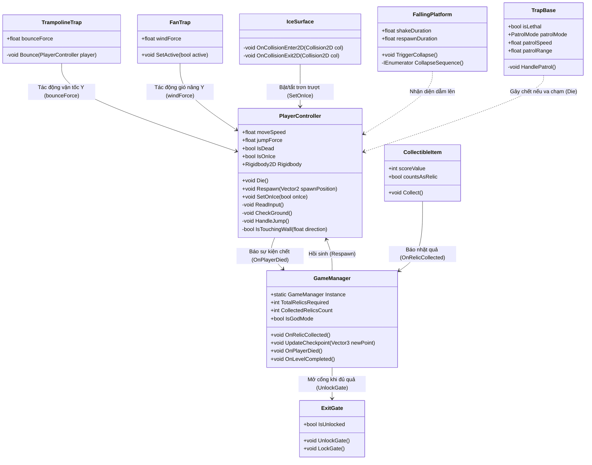

# SCHEMA CHI TIẾT DỰ ÁN "ONE HIT DOWN"
## TIÊU CHUẨN KIẾN TRÚC, ĐẶC TẢ API & PHÂN CÔNG 5 THÀNH VIÊN
**Dự án:** One Hit Down (2D Pixel Platformer)  
**Nền tảng:** Unity 6 (6000.x)  
**Ngôn ngữ:** C# (.NET Standard)  
**Quy ước kiến trúc:** Component-Based, Event-Driven, Prefab-First Workflow

---

## MỤC LỤC
1. [Hệ thống Quy chuẩn Toàn cục (Tags, Layers, Physics)](#1-hệ-thống-quy-chuẩn-toàn-cục)
2. [Sơ đồ Kiến trúc & Luồng Tương tác (Architecture Flow)](#2-sơ-đồ-kiến-trúc--luồng-tương-tác)
3. [Đặc tả Chi tiết Từng Script & Toàn bộ Hàm (Class & Method Specifications)](#3-đặc-tả-chi-tiết-từng-script--toàn-bộ-hàm)
   - [Module 1: Player Controller & Physics (Người 1)](#module-1-player-controller--physics-người-1)
   - [Module 2: Lethal Traps & Hazards (Người 2)](#module-2-lethal-traps--hazards-người-2)
   - [Module 3: Interactive Gadgets & Environmental Mechanics (Người 3)](#module-3-interactive-gadgets--environmental-mechanics-người-3)
   - [Module 4: Items, Objectives & Checkpoints (Người 4)](#module-4-items-objectives--checkpoints-người-4)
   - [Module 5: Game Management, Camera & Level Architecture (Người 5)](#module-5-game-management-camera--level-architecture-người-5)
4. [Đặc tả Cấu trúc Prefabs & Inspector Setup](#4-đặc-tả-cấu-trúc-prefabs--inspector-setup)
5. [Quy trình Phối hợp Nhóm & Chống Xung đột Git](#5-quy-trình-phối-hợp-nhóm--chống-xung-đột-git)

---

## 1. HỆ THỐNG QUY CHUẨN TOÀN CỤC

### 1.1. Bảng Quy chuẩn Tags (Tag Registry)
Cài đặt tại `Edit -> Project Settings -> Tags and Layers`:

| Tên Tag | Ý nghĩa & Mục đích sử dụng | Component sở hữu | Ai kiểm tra va chạm |
| :--- | :--- | :--- | :--- |
| **`"Hazard"`** | Đánh dấu vật thể gây chết ngay lập tức khi chạm vào (Gai, Cưa, Lửa, Hố sâu). | Gai nhọn, Lưỡi cưa, Bẫy lửa | `PlayerController` trong `OnTriggerEnter2D` |
| **`"Player"`** | Đánh dấu nhân vật người chơi (cả Player 1 và Player 2 đều dùng chung Tag này để bẫy và item nhận diện tức thì). | `Player1`, `Player2` | Bẫy, Hoa quả, Đệm nhún, Quạt gió, Cổng đích |
| **`"Item"`** | Đánh dấu vật phẩm có thể thu thập được. | Hoa quả, Cổ vật, Hòm đồ | `PlayerController` |
| **`"Untagged"`** | Mặc định cho sàn gạch, đệm nhún (TUYỆT ĐỐI không gắn Hazard lên đệm nhún). | Đệm nhún, Đường băng, Quạt | - |

### 1.2. Bảng Quy chuẩn Physics Layers & LayerMask
| Layer ID | Tên Layer | Ý nghĩa | Thiết lập va chạm (Physics 2D Matrix) |
| :--- | :--- | :--- | :--- |
| **Layer 0** | `Default` | Các vật thể cơ bản, UI, trang trí. | Va chạm mặc định. |
| **Layer 8** | `Ground` | Sàn gạch, tường chắn, trần nhà (Tilemap `Ground`). | Va chạm với `Player`, dùng cho `GroundCheck` & chống dính tường. |
| **Layer 9** | `Player` | Nhân vật người chơi (`Player1`). | Va chạm với `Ground`, nhận Trigger từ `Hazard` và `Item`. |
| **Layer 10** | `Traps` | Toàn bộ bẫy chướng ngại vật. | Chứa các Collider dạng Trigger hoặc Solid. |

---

## 2. SƠ ĐỒ KIẾN TRÚC & LUỒNG TƯƠNG TÁC

---

## 3. ĐẶC TẢ CHI TIẾT TỪNG SCRIPT & TOÀN BỘ HÀM

---

### MODULE 1: PLAYER CONTROLLER & PHYSICS (Người 1)
**File mã nguồn:** [`Assets/Scripts/Player/PlayerController.cs`](file:///D:/Onehitdown/Assets/Scripts/Player/PlayerController.cs)  
**Namespace:** `OneHitDown.Player`

#### Biến thành viên (Fields):
* `public enum PlayerType { Player1, Player2 }` : Kiểu người chơi.
* `[Header("Định danh Người chơi (Dùng chung 1 script cho cả 1 người và 2 người)")]`
* `[SerializeField] private PlayerType playerType = PlayerType.Player1;` : Chọn `Player1` (phím A/D/Space) hoặc `Player2` (phím Mũi tên ←/→/↑).
* `[SerializeField] private float moveSpeed = 8f;` : Tốc độ chạy ngang.
* `[SerializeField] private float jumpForce = 14f;` : Lực nhảy đơn từ mặt đất.
* `[SerializeField] private float doubleJumpForce = 13.5f;` : Lực nhảy đôi trên không.
* `[SerializeField] private float defaultGravityScale = 3.5f;` : Trọng lực chuẩn.
* `[SerializeField] private float coyoteTime = 0.1f;` : Thời gian ân hạn sau khi rời mép vực.
* `[SerializeField] private float jumpBufferTime = 0.1f;` : Thời gian ân hạn bấm nhảy trước khi chạm đất.
* `[SerializeField] private Transform groundCheck;` : Điểm kiểm tra chân chạm sàn.
* `[SerializeField] private Vector2 groundCheckSize = new Vector2(0.5f, 0.1f);` : Vùng quét chân.
* `[SerializeField] private LayerMask groundLayer;` : Layer mặt đất (`Ground`).
* `[SerializeField] private float iceFriction = 4f;` : Tốc độ đổi vận tốc trên băng (càng nhỏ càng trơn).
* `private Rigidbody2D rb;` : Tham chiếu vật lý.
* `private Animator anim;` : Tham chiếu bộ hoạt ảnh.
* `private SpriteRenderer spriteRenderer;` : Tham chiếu renderer để lật hình.
* `private float horizontalInput;` : Giá trị trục ngang (-1, 0, 1).
* `private bool isGrounded;` : Trạng thái đang đứng trên mặt đất.
* `private bool canDoubleJump;` : Cờ cho phép nhảy đôi.
* `private bool isDead;` : Cờ trạng thái đã chết.
* `private bool isOnIce;` : Cờ trạng thái đang đứng trên đường băng.

#### Thuộc tính & Sự kiện công khai (Public Properties & Events):
* `public bool IsDead => isDead;` : Đọc trạng thái sống/chết.
* `public Rigidbody2D Rigidbody => rb;` : Đọc Rigidbody để Trap tác động lực.
* `public bool IsOnIce => isOnIce;` : Đọc trạng thái trượt băng.
* `public event Action OnPlayerDied;` : Bắn ra khi chết để GameManager lắng nghe.
* `public event Action OnDoubleJumped;` : Bắn ra khi thực hiện nhảy đôi.

#### Danh sách toàn bộ các hàm (Methods):
1. `private void Awake()`
   * **Nhiệm vụ:** Lấy tham chiếu component. Gán `gravityScale`, bật `Continuous` collision. Tạo và gán `PhysicsMaterial2D` có ma sát = 0 (`friction = 0f`) vào toàn bộ collider để **chống dính tường**.
2. `private void Update()`
   * **Nhiệm vụ:** Kiểm tra `if (isDead) return;`. Gọi `ReadInput()`. Đếm lùi `coyoteCounter` và `jumpBufferCounter`. Gọi `HandleJump()`. Gọi `UpdateVisuals()`.
3. `private void FixedUpdate()`
   * **Nhiệm vụ:** Kiểm tra `if (isDead) return;`. Gọi `CheckGround()`. Tính `vel.x`: Nếu `isOnIce` dùng `Mathf.MoveTowards`, ngược lại gán `horizontalInput * moveSpeed`. Nếu đang trên không và chạm tường theo hướng di chuyển (`IsTouchingWall`), triệt tiêu `vel.x = 0`. Gán `rb.linearVelocity = vel`.
4. `private void ReadInput()`
   * **Nhiệm vụ:** Đọc phím độc lập theo `playerType`:
     * **Nếu là `Player1`:** Nhận phím `A`/`D` để tính `horizontalInput` (-1, 1); nhận phím `Space` hoặc `W` để đặt `jumpBufferCounter = jumpBufferTime`.
     * **Nếu là `Player2`:** Nhận phím Mũi tên `LeftArrow`/`RightArrow` để tính `horizontalInput`; nhận phím `UpArrow` để đặt `jumpBufferCounter = jumpBufferTime`.
5. `private void CheckGround()`
   * **Nhiệm vụ:** Quét hộp `Physics2D.OverlapBox(groundCheck.position, groundCheckSize, 0f, groundLayer)`. Cập nhật `isGrounded = (hit != null && rb.linearVelocity.y <= 0.2f)`. Nếu chạm đất: reset `coyoteCounter = coyoteTime` và `canDoubleJump = true`.
6. `private void HandleJump()`
   * **Nhiệm vụ:** Nếu `jumpBufferCounter > 0`: ưu tiên nhảy đất nếu `coyoteCounter > 0`; nhảy đôi nếu `canDoubleJump == true`.
7. `private void ExecuteJump(float force)`
   * **Tham số:** `float force`
   * **Nhiệm vụ:** Gán `rb.linearVelocity.y = force`.
8. `private void UpdateVisuals()`
   * **Nhiệm vụ:** Lật hình: `spriteRenderer.flipX = (horizontalInput < -0.05f)`. Cập nhật tham số Animator: `isGrounded`, `speed`, `verticalVelocity`.
9. `private bool IsTouchingWall(float direction)`
   * **Tham số:** `float direction`
   * **Trả về:** `bool` (true nếu chạm tường)
   * **Nhiệm vụ:** Bắn raycast ngang `Physics2D.Raycast` từ giữa thân nhân vật sang trái/phải với cự ly 0.55f kiểm tra Layer `Ground`.
10. `private void OnTriggerEnter2D(Collider2D collision)`
    * **Tham số:** `Collider2D collision`
    * **Nhiệm vụ:** Nếu `collision.CompareTag("Hazard")`, gọi `Die()`.
11. `public void Die()`
    * **Phạm vi:** `public void`
    * **Nhiệm vụ:** Đánh dấu `isDead = true`, dừng vật lý `rb.linearVelocity = Vector2.zero`, chạy trigger hoạt ảnh `Hit`, bắn sự kiện `OnPlayerDied`.
12. `public void Respawn(Vector2 spawnPosition)`
    * **Phạm vi:** `public void`
    * **Tham số:** `Vector2 spawnPosition`
    * **Nhiệm vụ:** Reset `isDead = false`, `isOnIce = false`. Chuyển tọa độ `transform.position = spawnPosition`. Dừng vận tốc, Rebind Animator.
13. `public void SetOnIce(bool onIce)`
    * **Phạm vi:** `public void`
    * **Tham số:** `bool onIce`
    * **Nhiệm vụ:** Gán `isOnIce = onIce`.

---

### MODULE 2: LETHAL TRAPS & HAZARDS (Người 2)
**Thư mục mã nguồn:** `Assets/Scripts/Traps/`  
**Namespace:** `OneHitDown.Traps`

#### 1. File: `TrapBase.cs` (Bẫy cơ bản & tuần tra)
* **Biến:**
  * `[SerializeField] private bool isLethal = true;` : Bẫy có gây chết không.
  * `[SerializeField] private PatrolMode patrolMode = PatrolMode.None;` : Chế độ tuần tra (`None`, `PingPong`, `Loop`).
  * `[SerializeField] private PatrolAxis patrolAxis = PatrolAxis.Horizontal;` : Hướng tuần tra (`Horizontal`, `Vertical`).
  * `[SerializeField] private float patrolSpeed = 2f;` : Tốc độ tuần tra.
  * `[SerializeField] private float patrolRange = 3f;` : Khoảng cách tuần tra.
  * `private Vector3 startPosition;` : Điểm gốc ban đầu.
* **Các hàm:**
  1. `private void Awake()`: Lưu `startPosition = transform.position`. Tự gắn tag `"Hazard"` nếu chưa có.
  2. `private void Update()`: Nếu `patrolMode == PatrolMode.PingPong`, tính khoảng lệch bằng `Mathf.PingPong(Time.time * patrolSpeed, patrolRange)` và dời vị trí `transform.position`.
  3. `private void OnTriggerEnter2D(Collider2D collision)`: Nếu chạm đối tượng mang component `PlayerController`, gọi `player.Die()`.
  4. `private void OnCollisionEnter2D(Collision2D collision)`: Tương tự trigger, bảo hiểm cho collider dạng solid.

#### 2. File: `SawSpinner.cs` (Xoay lưỡi cưa)
* **Biến:** `[SerializeField] private float rotationSpeed = 720f;` (độ/giây).
* **Các hàm:**
  1. `private void Update()`: Gọi `transform.Rotate(0f, 0f, -rotationSpeed * Time.deltaTime);`.

#### 3. File: `FireTrap.cs` (Bẫy phun lửa định thời)
* **Biến:**
  * `[SerializeField] private float activeTime = 2f;` : Thời gian phun lửa.
  * `[SerializeField] private float cooldownTime = 2f;` : Thời gian tắt lửa.
  * `[SerializeField] private Sprite fireOnSprite;`
  * `[SerializeField] private Sprite fireOffSprite;`
  * `[SerializeField] private Collider2D fireHazardTrigger;`
* **Các hàm:**
  1. `private void Awake()`: Lấy `SpriteRenderer` và `Collider2D`.
  2. `private void Start()`: Gọi `StartCoroutine(FireCycleRoutine());`.
  3. `private IEnumerator FireCycleRoutine()`: Lặp vô tận `while (true)`:
     * Đổi sprite sang `fireOnSprite`, bật `fireHazardTrigger.enabled = true`.
     * `yield return new WaitForSeconds(activeTime);`
     * Đổi sprite sang `fireOffSprite`, tắt `fireHazardTrigger.enabled = false`.
     * `yield return new WaitForSeconds(cooldownTime);`
  4. `private void OnTriggerEnter2D(Collider2D collision)`: Nếu `fireHazardTrigger.enabled == true` và chạm Player, gọi `player.Die()`.

---

### MODULE 3: INTERACTIVE GADGETS & ENVIRONMENTAL MECHANICS (Người 3)
**Thư mục mã nguồn:** `Assets/Scripts/Traps/`  
**Namespace:** `OneHitDown.Traps`

#### 1. File: `TrampolineTrap.cs` (Đệm nhún lò xo)
* **Biến:**
  * `[SerializeField] private float bounceForce = 22f;` : Lực đẩy nảy cao theo trục Y.
  * `[SerializeField] private Animator animator;` : Animator nhún của đệm.
* **Các hàm:**
  1. `private void Awake()`: Tự tìm `animator = GetComponent<Animator>()`. Xóa bỏ tag `Hazard` nếu bị gắn nhầm (`gameObject.tag = "Untagged"`).
  2. `private void OnTriggerEnter2D(Collider2D collision)`: Tìm `PlayerController player = collision.GetComponent<PlayerController>()`. Nếu hợp lệ và `!player.IsDead`: gọi `Bounce(player)`.
  3. `private void OnCollisionEnter2D(Collision2D collision)`: Tương tự trigger cho collider dạng solid.
  4. `private void Bounce(PlayerController player)`
     * **Tham số:** `PlayerController player`
     * **Nhiệm vụ:** Đẩy vận tốc Y của player: `vel.y = bounceForce`. Gọi hoạt ảnh nhún lập tức từ frame 0: `animator.Play("Jump", 0, 0f)`.

#### 2. File: `FanTrap.cs` (Bẫy quạt gió thổi bổng)
* **Biến:**
  * `[SerializeField] private float windForce = 16f;` : Vận tốc gió nâng người chơi.
  * `[SerializeField] private bool isActive = true;` : Trạng thái hoạt động.
  * `[SerializeField] private Sprite[] animationFrames;` : Mảng 4 sprite cánh quạt quay.
  * `[SerializeField] private Sprite offSprite;` : Sprite khi tắt quạt.
  * `[SerializeField] private float animationFps = 18f;` : Tốc độ quay cánh quạt.
  * `private SpriteRenderer sr;`, `private float frameTimer;`, `private int currentFrame;`
* **Các hàm:**
  1. `private void Awake()`: Lấy `sr = GetComponent<SpriteRenderer>()`.
  2. `private void Update()`: Nếu `!isActive` gán sprite tắt. Ngược lại đếm `frameTimer += Time.deltaTime`, khi đủ chu kỳ thì đổi sprite `currentFrame = (currentFrame + 1) % animationFrames.Length`.
  3. `private void OnTriggerStay2D(Collider2D collision)`: Bắt Player trong vùng gió. Nếu `isActive == true` và `player.Rigidbody != null`: gán `vel.y = Mathf.Max(vel.y, windForce)`.
  4. `public void SetActive(bool active)`:
     * **Phạm vi:** `public void`
     * **Nhiệm vụ:** Bật/tắt trạng thái hoạt động của quạt gió.

#### 3. File: `FallingPlatform.cs` (Sàn sụt lún / Hố sụt)
* **Biến:**
  * `[SerializeField] private float shakeDuration = 0.4f;` : Thời gian rung cảnh báo.
  * `[SerializeField] private float respawnDuration = 3.0f;` : Thời gian phục hồi sàn.
  * `[SerializeField] private float fallSpeed = 12f;` : Vận tốc sàn rơi.
  * `[SerializeField] private Sprite activeSprite;` : Sprite sàn nguyên vẹn.
  * `[SerializeField] private Sprite collapsedSprite;` : Sprite sàn nứt/sập.
  * `private Vector3 startPosition;`, `private bool isTriggered;`
* **Các hàm:**
  1. `private void Awake()`: Lưu `startPosition = transform.position`. Gán `sr.sprite = activeSprite`.
  2. `private void OnCollisionEnter2D(Collision2D collision)`: Duyệt `collision.contacts`. Nếu có va chạm giẫm từ trên xuống (`contact.normal.y < -0.3f`) và chưa kích hoạt: gọi `TriggerCollapse()`.
  3. `public void TriggerCollapse()`:
     * **Phạm vi:** `public void`
     * **Nhiệm vụ:** Đánh dấu `isTriggered = true`, chạy `StartCoroutine(CollapseSequence())`.
  4. `private IEnumerator CollapseSequence()`:
     * **Bước 1:** Rung lắc nhẹ trục X trong `shakeDuration` (0.4s).
     * **Bước 2:** Đổi sang `collapsedSprite`, tắt `solidCollider.enabled = false`.
     * **Bước 3:** Di chuyển vị trí xuống dưới theo `fallSpeed` trong 1.0s, sau đó ẩn `sr.enabled = false`.
     * **Bước 4:** `yield return new WaitForSeconds(respawnDuration);` (chờ 3s).
     * **Bước 5:** Đưa về `startPosition`, bật lại `solidCollider.enabled = true`, bật `sr.enabled = true`, đổi về `activeSprite`, gán `isTriggered = false`.

#### 4. File: `DeathPitTrap.cs` (Bẫy hố tử thần / Bẫy lún ngụy trang sập bất ngờ - `DEATH_PIT`)
> ⚠️ **ĐẶC ĐIỂM BẤT NGỜ CỐT LÕI:** Bề ngoài nhìn giống hệt một ô sàn gạch/khối đất bình thường (`Blocks/Idle.png`). Khi người chơi vừa giẫm chân vào, sàn lập tức rung giật trong tích tắc (0.2s) rồi **sập vĩnh viễn** thành hố sâu tử thần!
* **Biến:**
  * `[SerializeField] private float collapseDelay = 0.2f;` : Thời gian cảnh báo siêu ngắn trước khi sập.
  * `[SerializeField] private SpriteRenderer blockRenderer;` : Hình ảnh khối sàn ngụy trang.
  * `[SerializeField] private Collider2D solidCollider;` : Va chạm sàn rắn ban đầu để đứng lên.
  * `[SerializeField] private Collider2D deathTrigger;` : Vùng kích hoạt chết bên dưới hố (gắn tag `Hazard`).
  * `private bool isTriggered = false;`
* **Các hàm:**
  1. `private void Awake()`: Bật `solidCollider.enabled = true`, bật `blockRenderer.enabled = true`, tắt `deathTrigger.enabled = false`.
  2. `private void OnCollisionEnter2D(Collision2D collision)`: Nếu chạm người chơi (`collision.gameObject.CompareTag("Player")`) và chưa kích hoạt: gọi `TriggerCollapse()`.
  3. `public void TriggerCollapse()`:
     * **Phạm vi:** `public void`
     * **Nhiệm vụ:** Đánh dấu `isTriggered = true`, chạy `StartCoroutine(CollapseRoutine(collapseDelay))`.
  4. `private IEnumerator CollapseRoutine(float delay)`:
     * **Bước 1:** Rung lắc trong tích tắc (`delay = 0.2s`).
     * **Bước 2 (SẬP VĨNH VIỄN):** Tắt `solidCollider.enabled = false`, tắt `blockRenderer.enabled = false`.
     * **Bước 3:** Bật `deathTrigger.enabled = true` (tag `Hazard`), người chơi rơi xuống hố chết ngay. Hố không bao giờ phục hồi lại trong lượt chơi (`permanent: true`).

#### 5. File: `IceSurface.cs` (Bề mặt đường băng)
* **Các hàm:**
  1. `private void OnCollisionEnter2D(Collision2D collision)`: Nhận diện `PlayerController player`. Nếu có: gọi `player.SetOnIce(true)`.
  2. `private void OnCollisionStay2D(Collision2D collision)`: Duy trì: gọi `player.SetOnIce(true)`.
  3. `private void OnCollisionExit2D(Collision2D collision)`: Khi rời khỏi băng: gọi `player.SetOnIce(false)`.

---

### MODULE 4: ITEMS, OBJECTIVES & CHECKPOINTS (Người 4)
**Thư mục mã nguồn:** `Assets/Scripts/Items/`, `Assets/Scripts/Level/`

#### 1. File: `CollectibleItem.cs` (Hoa quả ăn được)
* **Namespace:** `OneHitDown.Items`
* **Biến:**
  * `[SerializeField] private int scoreValue = 10;` : Điểm thưởng khi nhặt.
  * `[SerializeField] private bool countsAsRelic = true;` : Có tính vào điều kiện mở cổng không.
  * `private bool isCollected = false;`
* **Các hàm:**
  1. `private void Awake()`: Đảm bảo `GetComponent<Collider2D>().isTrigger = true`.
  2. `private void OnTriggerEnter2D(Collider2D collision)`: Nếu chạm Player và `!isCollected`: gọi `Collect()`.
  3. `public void Collect()`:
     * **Phạm vi:** `public void`
     * **Nhiệm vụ:** Gán `isCollected = true`. Nếu `countsAsRelic == true` gọi `GameManager.Instance.OnRelicCollected()`. Gọi `Destroy(gameObject)`.

#### 2. File: `ExitGate.cs` (Cổng thoát hiểm hoàn thành màn - hỗ trợ 1 hoặc 2 người)
* **Namespace:** `OneHitDown.Level`
* **Biến:**
  * `[SerializeField] private Sprite lockedSprite;` : Sprite cổng đóng.
  * `[SerializeField] private Sprite unlockedSprite;` : Sprite cổng mở phát sáng.
  * `[SerializeField] private bool requireBothPlayers = false;` : Cờ yêu cầu cả 2 người cùng vào cổng mới qua màn (Mặc định `false` cho chế độ 1 người; bật `true` khi chơi Co-op 2 người).
  * `private bool isUnlocked = false;`
  * `private int playersInGate = 0;` : Đếm số người chơi đang đứng trong cổng.
* **Thuộc tính:** `public bool IsUnlocked => isUnlocked;`
* **Các hàm:**
  1. `private void Awake()`: Gán `isUnlocked = false`, đặt sprite `lockedSprite`.
  2. `private void OnTriggerEnter2D(Collider2D collision)`:
     * Nếu `collision.CompareTag("Player")`:
       * Tăng `playersInGate++`.
       * Nếu `isUnlocked == true` và `(!requireBothPlayers || playersInGate >= 2)`: gọi `GameManager.Instance.OnLevelCompleted()`.
  3. `private void OnTriggerExit2D(Collider2D collision)`:
     * Nếu `collision.CompareTag("Player")`: giảm `playersInGate = Mathf.Max(0, playersInGate - 1)`.
  4. `public void UnlockGate()`:
     * **Phạm vi:** `public void`
     * **Nhiệm vụ:** Gán `isUnlocked = true`, đổi sprite sang `unlockedSprite`.
  5. `public void LockGate()`:
     * **Phạm vi:** `public void`
     * **Nhiệm vụ:** Gán `isUnlocked = false`, đổi sprite sang `lockedSprite`.
#### 3. File: `Checkpoint.cs` (Lá cờ lưu điểm hồi sinh)
* **Namespace:** `OneHitDown.Level`
* **Biến:**
  * `[SerializeField] private Animator flagAnimator;`
  * `private bool isActivated = false;`
* **Thuộc tính:** `public bool IsActivated => isActivated;`
* **Các hàm:**
  1. `private void Awake()`: Đảm bảo Collider có `isTrigger = true`.
  2. `private void OnTriggerEnter2D(Collider2D collision)`: Nếu chạm Player và `!isActivated`: gọi `ActivateCheckpoint()`.
  3. `public void ActivateCheckpoint()`:
     * **Phạm vi:** `public void`
     * **Nhiệm vụ:** Gán `isActivated = true`. Chạy trigger hoạt ảnh cờ bay: `flagAnimator.SetTrigger("FlagOut")`. Gọi `GameManager.Instance.UpdateCheckpoint(transform.position)`.

---

### MODULE 5: GAME MANAGEMENT, CAMERA & LEVEL ARCHITECTURE (Người 5)
**Thư mục mã nguồn:** `Assets/Scripts/Core/`  
**Namespace:** `OneHitDown.Core`

#### 1. File: `GameManager.cs` (Trọng tài toàn hệ thống)
* **Biến:**
  * `public static GameManager Instance { get; private set; }` : Singleton toàn cục.
  * `[SerializeField] private PlayerController player1;` : Tham chiếu người chơi.
  * `[SerializeField] private ExitGate exitGate;` : Tham chiếu cổng đích.
  * `[SerializeField] private int totalRelicsRequired = 4;` : Tổng số quả cần gom để mở cổng.
  * `[SerializeField] private float respawnDelay = 0.15f;` : Độ trễ hồi sinh siêu tốc.
  * `private Vector3 currentCheckpointPos;` : Tọa độ hồi sinh hiện tại.
  * `private int collectedRelicsCount = 0;` : Số quả hiện đã nhặt.
  * `private bool isGodMode = false;` : Bất tử khi test.
* **Thuộc tính:**
  * `public bool IsGodMode => isGodMode;`
  * `public int TotalRelicsRequired => totalRelicsRequired;`
  * `public int CollectedRelicsCount => collectedRelicsCount;`
* **Các hàm:**
  1. `private void Awake()`: Khởi tạo Singleton `if (Instance == null) Instance = this; else Destroy(gameObject);`. Tự động tìm `PlayerController` và `ExitGate` nếu Inspector để trống. Lưu `currentCheckpointPos = player1.transform.position`.
  2. `private void Start()`: Đăng ký lắng nghe: `player1.OnPlayerDied += OnPlayerDied;`.
  3. `private void Update()`: Bắt phím tiện ích: Bấm `R` gọi `player1.Respawn(currentCheckpointPos)`. Bấm `G` đổi cờ `isGodMode = !isGodMode`.
  4. `private IEnumerator RespawnRoutine()`: `yield return new WaitForSeconds(respawnDelay);` -> Gọi `player1.Respawn(currentCheckpointPos);`.
  5. `public void OnPlayerDied()`:
     * **Phạm vi:** `public void`
     * **Nhiệm vụ:** Kích hoạt `StartCoroutine(RespawnRoutine())`.
  6. `public void OnRelicCollected()`:
     * **Phạm vi:** `public void`
     * **Nhiệm vụ:** Tăng `collectedRelicsCount++`. Kiểm tra nếu `collectedRelicsCount >= totalRelicsRequired`: gọi `exitGate.UnlockGate()`.
  7. `public void UpdateCheckpoint(Vector3 newPoint)`:
     * **Phạm vi:** `public void`
     * **Tham số:** `Vector3 newPoint`
     * **Nhiệm vụ:** Cập nhật `currentCheckpointPos = newPoint`.
  8. `public void OnLevelCompleted()`:
     * **Phạm vi:** `public void`
     * **Nhiệm vụ:** Ghi log hoàn thành màn, hiển thị thông báo Win hoặc chuyển Scene tiếp theo.

#### 2. File: `CameraController.cs` (Camera mượt mà hỗ trợ 1 hoặc 2 người)
* **Biến:**
  * `[SerializeField] private Transform target;` : Mục tiêu 1 (`Player1`).
  * `[SerializeField] private Transform target2;` : Mục tiêu 2 (`Player2` - để trống khi chơi 1 người, gán khi chơi 2 người).
  * `[SerializeField] private float targetOrthoSize = 5f;` : Tầm nhìn chuẩn 2D Pixel.
  * `[SerializeField] private float smoothSpeed = 8f;` : Độ mượt chuyển động camera.
  * `[SerializeField] private Vector2 offset = new Vector2(1.5f, 1f);` : Độ lệch tầm nhìn trước.
  * `[SerializeField] private float minY = 2.5f;`, `[SerializeField] private float maxY = 18f;` : Biên độ kẹp trục Y.
* **Các hàm:**
  1. `private void Awake()`: Cài đặt `camera.orthographic = true`, `camera.orthographicSize = targetOrthoSize`.
  2. `private void LateUpdate()`:
     * **Xác định vị trí tâm theo dõi:**
       * Nếu có cả 2 người (`target != null && target2 != null`): Lấy trung điểm `focusPoint = (target.position + target2.position) / 2f;`.
       * Nếu chỉ có 1 người (`target != null`): Lấy `focusPoint = target.position;`.
     * Tính tọa độ đích: `desiredX = focusPoint.x + offset.x`, `desiredY = Mathf.Clamp(focusPoint.y + offset.y, minY, maxY)`.
     * Cập nhật mượt mà: `transform.position = Vector3.Lerp(transform.position, new Vector3(desiredX, desiredY, -10f), Time.deltaTime * smoothSpeed);`.
  3. `public void SetTargets(Transform t1, Transform t2 = null)`:
     * **Phạm vi:** `public void`
     * **Tham số:** `Transform t1, Transform t2 = null`
     * **Nhiệm vụ:** Đổi mục tiêu theo dõi của Camera (1 hoặc 2 người).

#### 3. File: `SoulTether.cs` (Sợi Dây Liên Kết Linh Hồn 2 Người - Co-op Soul Tether)
**File mã nguồn:** `Assets/Scripts/Player/SoulTether.cs`  
**Namespace:** `OneHitDown.Player`  
**Vai trò:** Kết nối Player 1 và Player 2 bằng sợi dây vật lý giới hạn khoảng cách và chia sẻ sự sống chết ("One Hit Down").

* **Biến thành viên (Fields):**
  * `[SerializeField] private PlayerController player1;` : Tham chiếu Người chơi 1 (Ninja Frog).
  * `[SerializeField] private PlayerController player2;` : Tham chiếu Người chơi 2 (Mask Dude).
  * `[SerializeField] private float maxDistance = 4f;` : Chiều dài tối đa của sợi dây (tối đa 4 ô gạch = 64px).
  * `[SerializeField] private Color tetherColor = new Color(0.2f, 0.8f, 1f, 0.8f);` : Màu sắc phát sáng của sợi dây.
  * `private LineRenderer lineRenderer;` : Vẽ sợi dây trực quan giữa 2 người.
  * `private DistanceJoint2D jointP1;` : Khớp nối vật lý 2D giới hạn khoảng cách.

* **Các hàm (Methods):**
  1. `private void Awake()`:
     * Lấy `lineRenderer = GetComponent<LineRenderer>()`.
     * Cấu hình 2 điểm đầu cuối: `lineRenderer.positionCount = 2;`, `lineRenderer.startWidth = 0.08f; lineRenderer.endWidth = 0.08f;`.
  2. `private void Start()`: Gọi `SetupPhysicsJoint()`.
  3. `private void SetupPhysicsJoint()`:
     * Thêm `DistanceJoint2D` vào `player1.gameObject`.
     * Gán `jointP1.connectedBody = player2.Rigidbody;`.
     * Đặt `jointP1.autoConfigureDistance = false; jointP1.distance = maxDistance; jointP1.maxDistanceOnly = true;` (chỉ kéo giật lại khi vượt quá 4 ô, trong phạm vi 4 ô di chuyển tự do).
  4. `private void Update()`:
     * Nếu 1 trong 2 người biến mất hoặc chết: ẩn `lineRenderer.enabled = false`.
     * Cập nhật vị trí 2 đầu dây:
       * `lineRenderer.SetPosition(0, player1.transform.position);`
       * `lineRenderer.SetPosition(1, player2.transform.position);`
     * **Cơ chế Sinh tử chia sẻ (One Hit Down):**
       * Nếu `player1.IsDead && !player2.IsDead` -> gọi `player2.Die();`.
       * Nếu `player2.IsDead && !player1.IsDead` -> gọi `player1.Die();`.

---

## 4. ĐẶC TẢ CẤU TRÚC PREFABS & INSPECTOR SETUP

Toàn bộ các đối tượng được đóng gói thành Prefab đặt tại `Assets/Prefabs/` với cấu trúc chuẩn:

| Tên Prefab | Root Components bắt buộc | Cài đặt Collider quan trọng | Tag | Layer |
| :--- | :--- | :--- | :--- | :--- |
| **`Player1.prefab`** | `Transform`, `SpriteRenderer` (NinjaFrog), `Animator`, `BoxCollider2D`, `Rigidbody2D`, `PlayerController` (`playerType = Player1`) | `Size: (0.85, 1.55)`, `Offset: (0, 0.78)`, `isTrigger = false`. Material: `Friction = 0`. | `"Player"` | `Player (9)` |
| **`Player2.prefab`** | `Transform`, `SpriteRenderer` (MaskDude), `Animator`, `BoxCollider2D`, `Rigidbody2D`, `PlayerController` (`playerType = Player2`) | `Size: (0.85, 1.55)`, `Offset: (0, 0.78)`, `isTrigger = false`. Material: `Friction = 0`. | `"Player"` | `Player (9)` |
| **`SoulTether.prefab`** | `Transform`, `LineRenderer`, `SoulTether` | Không collider. Dùng DistanceJoint2D liên kết 2 Player và vẽ tia laser chia sẻ sinh tử. | `"Untagged"` | `Default (0)` |
| **`Spikes.prefab`** | `Transform`, `SpriteRenderer`, `BoxCollider2D`, `TrapBase` | `Size: (0.8, 0.6)`, `Offset: (0, -0.2)`, `isTrigger = true`. | `"Hazard"` | `Traps (10)` |
| **`Saw.prefab`** | `Transform`, `SpriteRenderer`, `Animator`, `CircleCollider2D`, `SawSpinner`, `TrapBase` | `Radius: 1.0`, `isTrigger = true`. | `"Hazard"` | `Traps (10)` |
| **`Trampoline.prefab`** | `Transform`, `SpriteRenderer`, `Animator`, `BoxCollider2D`, `TrampolineTrap` | `Size: (1.6, 0.5)`, `Offset: (0, -0.25)`, `isTrigger = true`. | `"Untagged"` | `Traps (10)` |
| **`FanTrap.prefab`** | `Transform`, `SpriteRenderer`, `BoxCollider2D` (chân), `BoxCollider2D` (gió), `FanTrap` | Collider chân: `isTrigger = false`. Collider gió: `Size: (1.5, 4.4)`, `Offset: (0, 2.2)`, `isTrigger = true`. | `"Untagged"` | `Traps (10)` |
| **`FallingPlatform.prefab`**| `Transform`, `SpriteRenderer`, `BoxCollider2D`, `FallingPlatform` | `Size: (2.0, 0.625)`, `Offset: (0, 0)`, `isTrigger = false`. | `"Untagged"` | `Ground (8)` |
| **`DeathPit.prefab`** | `Transform`, `SpriteRenderer`, `BoxCollider2D` (sàn), `BoxCollider2D` (chết), `DeathPitTrap` | Collider sàn: `isTrigger = false`. Collider chết: `isTrigger = true` (Tag: `"Hazard"`). | `"Untagged"` | `Traps (10)` |
| **`IceRoad.prefab`** | `Transform`, `SpriteRenderer`, `BoxCollider2D`, `IceSurface` | `Size: (3.0, 0.75)`, `isTrigger = false`. | `"Untagged"` | `Ground (8)` |
| **`Fruit_*.prefab`** | `Transform`, `SpriteRenderer`, `CircleCollider2D`, `CollectibleItem` | `Radius: 0.5`, `isTrigger = true`. | `"Item"` | `Default (0)` |
| **`ExitGate.prefab`** | `Transform`, `SpriteRenderer`, `BoxCollider2D`, `ExitGate` | `Size: (1.2, 1.8)`, `isTrigger = true`. | `"Untagged"` | `Default (0)` |
| **`Checkpoint.prefab`** | `Transform`, `SpriteRenderer`, `Animator`, `BoxCollider2D`, `Checkpoint` | `Size: (1.0, 1.5)`, `isTrigger = true`. | `"Untagged"` | `Default (0)` |

---

## 5. QUY TRÌNH PHỐI HỢP NHÓM & CHỐNG XUNG ĐỘT GIT

1. **Quy tắc Branch Git:**
   * Nhánh chính: `main` (chỉ dùng để release).
   * Nhánh tích hợp: `dev` (dùng để gộp tính năng).
   * 5 thành viên tạo 5 nhánh tính năng riêng:
     * `feature/player` (Người 1)
     * `feature/lethal-traps` (Người 2)
     * `feature/gadgets` (Người 3)
     * `feature/items-gate` (Người 4)
     * `feature/level-assembly` (Người 5)
2. **Quy tắc file Scene:**
   * Người 1, 2, 3, 4 tuyệt đối **KHÔNG MỞ HOẶC COMMIT FILE `SampleScene.unity`**.
   * Mỗi người tự tạo scene riêng trong thư mục `Assets/Scenes/Dev/` (ví dụ: `Dev_Player.unity`, `Dev_Traps.unity`) để kiểm thử mã của mình.
   * Khi tính năng hoạt động ổn định, bấm chọn đối tượng trong Hierarchy -> Kéo vào thư mục `Assets/Prefabs/` để cập nhật Prefab.
   * Chỉ commit mã nguồn `.cs` và file `.prefab`.
3. **Quy tắc ráp màn của Người 5:**
   * Sau khi Người 1, 2, 3, 4 đã merge Prefab vào nhánh `dev`, Người 5 kéo code mới nhất về.
   * Người 5 mở `SampleScene.unity`, kéo thả các Prefab vào vị trí thiết kế trên Map.
   * Bấm **Play (`▶`)** chạy kiểm thử tổng thể, cân bằng nhịp độ và lưu Scene.
