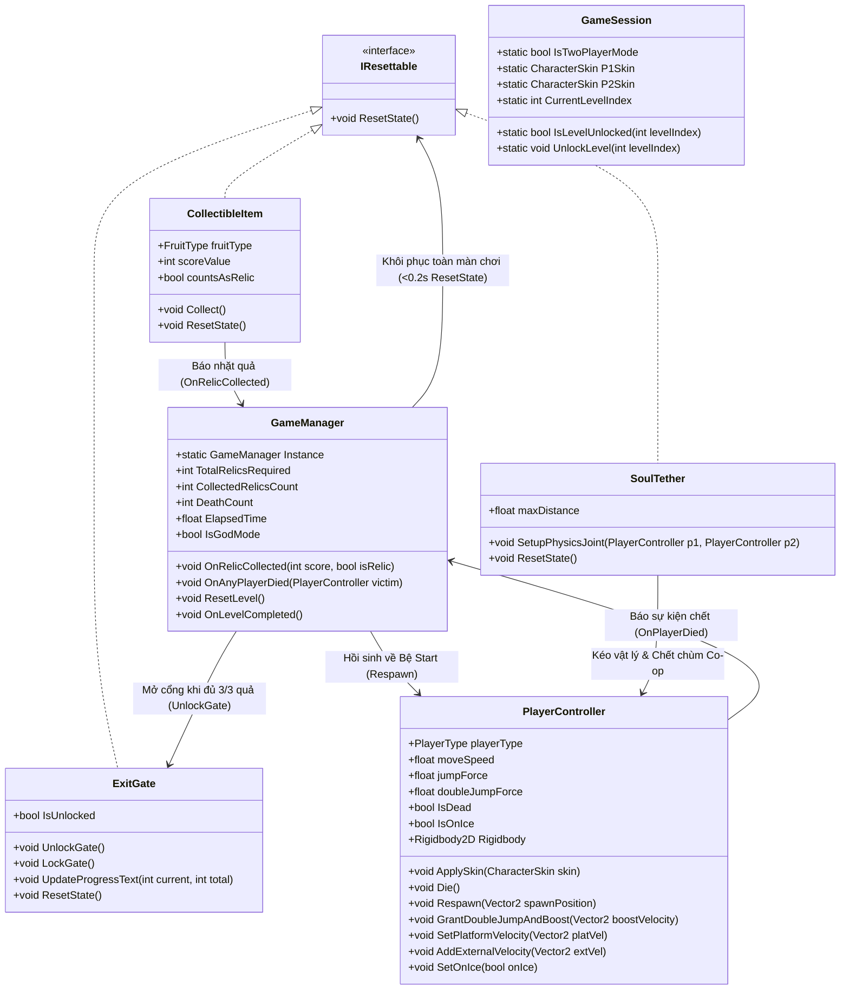

# SCHEMA CHI TIẾT DỰ ÁN "ONE HIT DOWN"
## TIÊU CHUẨN KIẾN TRÚC, ĐẶC TẢ API & PHÂN CÔNG 5 THÀNH VIÊN (PHIÊN BẢN ĐỒNG BỘ BÁO CÁO & FULL ASSETS)
**Dự án:** One Hit Down (2D Pixel Platformer)  
**Nền tảng:** Unity 6 (6000.x - Universal Render Pipeline 2D)  
**Ngôn ngữ:** C# (.NET Standard 2.1)  
**Quy ước kiến trúc:** Component-Based, Event-Driven, `IResettable` Instant-Reset, Prefab-First Workflow  
**Tài nguyên & Bản quyền:** Lưu trữ tại `Assets/Art/` (kèm giấy phép chuẩn tại `Assets/Art/09_GiayPhep/`)

---

## MỤC LỤC
1. [Hệ thống Quy chuẩn Toàn cục (PPU, Tags, Layers, 13 Bẫy & 8 Quả)](#1-hệ-thống-quy-chuẩn-toàn-cục)
2. [Sơ đồ Kiến trúc & Luồng Tương tác (Architecture Flow)](#2-sơ-đồ-kiến-trúc--luồng-tương-tác)
3. [Đặc tả Chi tiết Từng Script & Toàn bộ Hàm (Class & Method Specifications)](#3-đặc-tả-chi-tiết-từng-script--toàn-bộ-hàm)
   - [Module 1: Player Controller, Physics, 4 Skins & VFX (Người 1 - Tạ Anh Tuấn)](#module-1-player-controller-physics-4-skins--vfx-người-1---tạ-anh-tuấn)
   - [Module 2: Lethal Traps & Dynamic Crushers (Người 2 - Trần Đức Trung)](#module-2-lethal-traps--dynamic-crushers-người-2---trần-đức-trung)
   - [Module 3: Interactive Gadgets & Environmental Mechanics (Người 3 - Trần Văn Tuyên)](#module-3-interactive-gadgets--environmental-mechanics-người-3---trần-văn-tuyên)
   - [Module 4: Relics (8 Fruits), Moving Platform, Start/Exit Altar &Menus (Người 4 - Phan Văn Tú)](#module-4-relics-8-fruits-moving-platform-startexit-altar--menus-người-4---phan-văn-tú)
   - [Module 5: Core Manager, Instant Reset, Soul Tether, Audio & HUD (Người 5 - Hoàng Thị Giang Uyên)](#module-5-core-manager-instant-reset-soul-tether-audio--hud-người-5---hoàng-thị-giang-uyên)
4. [Đặc tả Cấu trúc Prefabs & Inspector Setup](#4-đặc-tả-cấu-trúc-prefabs--inspector-setup)
5. [Quy trình Phối hợp Nhóm & Chống Xung đột Git](#5-quy-trình-phối-hợp-nhóm--chống-xung-đột-git)

---

## 1. HỆ THỐNG QUY CHUẨN TOÀN CỤC

### 1.1. Quy chuẩn Đồ họa Pixel & Vật lý Cơ sở (Import Settings)
* **Pixels Per Unit (PPU):** Bắt buộc đặt **`Pixels Per Unit = 16`** cho toàn bộ Sprite địa hình (`16x16`), nhân vật (`32x32`), bẫy và vật phẩm. (1 đơn vị Unity = 1 Tile = 16×16 pixels).
* **Filter Mode:** `Point (no filter)` | **Compression:** `None` (giữ sắc nét Pixel Art).
* **Thông số Vật lý Chuẩn (khớp Bảng Level Design Metrics trong Báo cáo):**
  * Vận tốc chạy tối đa (`moveSpeed`): `8f` (8 tiles/s), có gia tốc lấy đà (`groundAcceleration = 65f`) để phân biệt **nhảy có đà chạy (xa 6 tiles = 96px)** và **nhảy đứng yên tại chỗ (xa 3 tiles = 48px)**.
  * Trọng lực (`defaultGravityScale`): `3.5f`.
  * Lực Nhảy Đơn (`jumpForce`): `15.5f` (đạt độ cao đỉnh đúng `3.5 tiles`).
  * Lực Nhảy Đôi (`doubleJumpForce`): `13.5f` (tổng độ cao 2 nhịp đạt `5.5 tiles`).

### 1.2. Bảng Quy chuẩn Tags (Tag Registry)
Cài đặt tại `Edit -> Project Settings -> Tags and Layers` (Người 1 thiết lập và commit `ProjectSettings/TagManager.asset` đầu tiên):

| Tên Tag | Ý nghĩa & Mục đích sử dụng | Component sở hữu | Ai kiểm tra va chạm |
| :--- | :--- | :--- | :--- |
| **`"Hazard"`** | Đánh dấu vật thể/collider gây chết ngay lập tức khi chạm vào (Gai, Cưa, Lửa, Búa Đá, Cầu Gai, Đáy Hố Tử Thần, KillZone). | `Spikes`, `Saw`, `FireHitbox`, `RockHead`, `SpikeHead`, `SpikedBall`, `DeathPitTrigger`, `KillZone` | `PlayerController` trong `OnTriggerEnter2D` / `OnCollisionEnter2D` |
| **`"Player"`** | Đánh dấu nhân vật người chơi (cả `Player1` và `Player2` đều dùng chung Tag này). | `Player1`, `Player2` | Toàn bộ Bẫy, Quả, Đệm nhún, Mũi tên, Quạt, Bệ di động, Cổng đích |
| **`"Item"`** | Đánh dấu vật phẩm có thể thu thập được (8 loại trái cây). | `Fruit_*.prefab` | `PlayerController` / `CollectibleItem` |
| **`"Untagged"`** | Mặc định cho sàn gạch, thân quạt, đệm nhún, bệ di động, mũi tên đẩy. | `Trampoline`, `ArrowBooster`, `Fan`, `MovingPlatform`, `IceRoad` | - |

### 1.3. Bảng Quy chuẩn Physics Layers & LayerMask
| Layer ID | Tên Layer | Ý nghĩa | Thiết lập va chạm (Physics 2D Matrix) |
| :--- | :--- | :--- | :--- |
| **Layer 0** | `Default` | Các vật thể cơ bản, UI, Vật phẩm, Cổng đích. | Va chạm mặc định. |
| **Layer 8** | `Ground` | Sàn gạch, tường chắn, `FallingPlatform`, `MovingPlatform`, thân `DeathPit` khi chưa sập, `IceRoad`. | Va chạm Solid với `Player`, dùng cho `GroundCheck` & chống dính tường. |
| **Layer 9** | `Player` | Nhân vật người chơi (`Player1`, `Player2`). | Không tự đẩy nhau (`Player` vs `Player` tắt va chạm solid), va chạm với `Ground` & `Traps`. |
| **Layer 10** | `Traps` | Toàn bộ bẫy sát thương và cơ quan tương tác. | Chứa các Collider dạng Trigger hoặc Solid. |

### 1.4. Đối chiếu Đầy đủ 13 Loại Bẫy (`03_Bay/PA1_Traps`) & 8 Loại Quả (`04_VatPham/PA1_Items/Fruits`)
* **7 Bẫy Sát Thương Trực Tiếp (Module 2 & Module 3):**
  1. `Spikes` (`Spikes/Idle.png` - 16×16): Chông gai cố định (sàn/trần/tường).
  2. `Saw` & `Saw on Chain` (`Saw/On (38x38).png` 8 frames, `Off.png`, `Chain.png`): Lưỡi cưa xoay tại chỗ hoặc tuần tra dọc ray xích.
  3. `Fire` (`Fire/Off.png`, `Hit (16x32).png` 4 frames cảnh báo, `On (16x32).png` 3 frames): Vạc dầu phun lửa chu kỳ **2s tắt – 0.35s nhấp nháy cảnh báo – 1s bật phun lửa**.
  4. `Rock Head` (`Rock Head/Idle.png`, `Blink (42x42).png` 4 frames, `Bottom/Top/Left/Right Hit`): Tượng đá nghiền cảm biến tiệm cận (`ON_PROXIMITY`), dập sập xuống sau `0.25s` rồi rút về trần.
  5. `Spike Head` (`Spike Head/Idle.png`, `Blink (54x52).png` 4 frames, `Bottom/Top/Left/Right Hit`): Khối đá gai phóng ngang/dọc tốc độ cao, đập đối xứng trong khe hẹp.
  6. `Spiked Ball` (`Spiked Ball/Spiked Ball.png` 28×28, `Chain.png`): Quả cầu gai xích sắt đung đưa như con lắc đơn quanh trục treo.
  7. `Blocks / DeathPit` (`Blocks/Idle.png`, `HitTop (22x22).png`, `Part 1 & 2`): Sàn đá ngụy trang, giẫm lên rung `0.2s` rồi vỡ nát thành **Hố Tử Thần Vĩnh Viễn** (chỉ khôi phục khi toàn đội chết và `ResetLevel()`).
* **6 Cơ Quan Tương Tác & Môi Trường (Module 3 & Module 4):**
  8. `Trampoline` (`Trampoline/Idle.png`, `Jump (28x28).png` 8 frames): Đệm lò xo đẩy bật theo hướng cấu hình (`bounceDirection`, hỗ trợ đặt thẳng hoặc nghiêng).
  9. `Falling Platforms` (`Falling Platforms/On (32x10).png` 4 frames, `Off.png`): Bệ đá treo rung `0.4s` khi giẫm lên rồi sụp rơi (hỗ trợ cả chế độ tự hồi sau `3s` hoặc sập vĩnh viễn suốt lượt chơi `isPermanent = true`).
  10. `Fan` (`Fan/Off.png`, `On (24x8).png` 4 frames): Cối xay quạt gió thổi luồng khí theo hướng cấu hình (`windDirection` thổi lên hoặc thổi ngang xuôi/ngược chiều).
  11. `Sand Mud Ice` (`Sand Mud Ice (16x6).png`, `Ice/Mud/Sand Particle.png`): Mặt sàn băng trơn trượt giảm ma sát tối đa.
  12. `Arrow` (`Arrow/Idle (18x18).png` 10 frames, `Hit (18x18).png` 4 frames): **Bong Bóng Mũi Tên Đẩy Khí & Hồi Nhảy Đôi** — khi nhân vật chạm vào trên không sẽ được hất nhẹ lên (`boostForce = 14f`), **hồi ngay lập tức 1 lượt `canDoubleJump = true`**, phát anim `Hit` rồi ẩn đi `2.5s` trước khi hiện lại.
  13. `Platforms / MovingPlatform` (`Platforms/Brown On (32x8).png`, `Grey On (32x8).png` 8 frames, `Chain.png`): Bệ nâng di động tuần tra ngang/dọc theo đường dây xích, tự động truyền vận tốc kéo theo người chơi đứng trên bệ.
* **8 Loại Quả Phong Ấn & Thưởng (`04_VatPham_dungOrkhong/PA1_Items/Fruits`):**
  * **5 Quả Cổ Vật Chính (mỗi màn đặt đúng 3 quả bắt buộc `countsAsRelic = true` để mở Cổng Thần `[3/3]`):** Màn 1: `Apple.png` | Màn 2: `Bananas.png` | Màn 3: `Kiwi.png` | Màn 4: `Orange.png` | Màn 5: `Pineapple.png`.
  * **3 Quả Thưởng Phụ (`countsAsRelic = false`, cộng điểm thưởng & thử thách phụ):** `Cherries.png` (Màn 1, 4), `Melon.png` (Màn 2, 5), `Strawberry.png` (Màn 3, 5).
  * Tất cả 8 loại quả đều có sheet `544×32` (17 frames × 32×32) và dùng chung hiệu ứng ăn quả `Collected.png` (`192×32` = 6 frames).

---

## 2. SƠ ĐỒ KIẾN TRÚC & LUỒNG TƯƠNG TÁC



---

## 3. ĐẶC TẢ CHI TIẾT TỪNG SCRIPT & TOÀN BỘ HÀM

### Giao diện Dùng Chung: `IResettable.cs`
* **File mã nguồn:** `Assets/Scripts/Core/IResettable.cs` | **Namespace:** `OneHitDown.Core`
* **Mục đích:** Vì trò chơi áp dụng quy tắc **"Chết là hồi sinh tức thì về Bệ Xuất Phát đầu màn và khôi phục toàn bộ trạng thái màn chơi"** (không dùng Checkpoint giữa màn), mọi vật phẩm, bẫy sập và cơ quan động đều cài đặt giao diện này:
  ```csharp
  namespace OneHitDown.Core {
      public interface IResettable {
          void ResetState();
      }
  }
  ```

---

### MODULE 1: PLAYER CONTROLLER, PHYSICS, 4 SKINS & VFX (Người 1 - Tạ Anh Tuấn)
**Thư mục mã nguồn:** `Assets/Scripts/Player/`  
**Namespace:** `OneHitDown.Player`

#### 1. File: `PlayerController.cs` (Điều khiển Vật lý, Gia tốc Đà chạy, Nhảy Đôi & Tương tác Dây Xích)
* **Enums:**
  * `public enum PlayerType { Player1, Player2 }`
  * `public enum CharacterSkin { NinjaFrog = 0, VirtualGuy = 1, PinkMan = 2, MaskDude = 3 }`
* **Biến thành viên (Fields):**
  * `[SerializeField] private PlayerType playerType = PlayerType.Player1;`
  * `[SerializeField] private RuntimeAnimatorController[] skinControllers;` : Mảng 4 Animator Controller/Override cho 4 Skins (`NinjaFrog`, `VirtualGuy`, `PinkMan`, `MaskDude`).
  * `[SerializeField] private float moveSpeed = 8f;` : Vận tốc tối đa (8 tiles/s).
  * `[SerializeField] private float groundAcceleration = 65f;` : Gia tốc lấy đà trên mặt đất (đạt tốc độ tối đa sau ~0.12s, giúp nhảy có đà đạt 6 tiles và nhảy đứng yên đạt 3 tiles).
  * `[SerializeField] private float groundDeceleration = 80f;` : Gia tốc dừng khi nhả phím.
  * `[SerializeField] private float airAcceleration = 45f;` : Gia tốc điều hướng trên không.
  * `[SerializeField] private float iceFriction = 4f;` : Gia tốc trượt trên mặt băng.
  * `[SerializeField] private float jumpForce = 15.5f;` : Lực nhảy đơn (cao 3.5 tiles với `gravityScale = 3.5`).
  * `[SerializeField] private float doubleJumpForce = 13.5f;` : Lực nhảy đôi (tổng độ cao 5.5 tiles).
  * `[SerializeField] private float defaultGravityScale = 3.5f;`
  * `[SerializeField] private float coyoteTime = 0.1f;` : Thời gian ân hạn rời mép vực.
  * `[SerializeField] private float jumpBufferTime = 0.1f;` : Thời gian ân hạn bấm nhảy sớm.
  * `[SerializeField] private Transform groundCheck;`
  * `[SerializeField] private Vector2 groundCheckSize = new Vector2(0.55f, 0.12f);`
  * `[SerializeField] private LayerMask groundLayer;`
  * `private Rigidbody2D rb;`, `private Animator anim;`, `private SpriteRenderer spriteRenderer;`
  * `private float horizontalInput;`, `private float coyoteCounter;`, `private float jumpBufferCounter;`
  * `private bool isGrounded;`, `private bool canDoubleJump;`, `private bool isDead;`, `private bool isOnIce;`
  * `private Vector2 platformVelocity;` : Vận tốc cộng thêm khi đứng trên `MovingPlatform`.
  * `private Vector2 externalVelocity;` : Vận tốc ngoại lực từ quạt gió, đệm nghiêng hoặc lực giật của dây xích `SoulTether` (giảm dần mượt về 0 để **không làm mất lực kéo của `DistanceJoint2D`**).
* **Thuộc tính & Sự kiện công khai:**
  * `public PlayerType Type => playerType;`
  * `public bool IsDead => isDead;`
  * `public bool IsGrounded => isGrounded;`
  * `public bool IsOnIce => isOnIce;`
  * `public float HorizontalInput => horizontalInput;`
  * `public Rigidbody2D Rigidbody => rb;`
  * `public event Action<PlayerController> OnPlayerDied;`
  * `public event Action OnSingleJumped;`
  * `public event Action OnDoubleJumped;`
  * `public event Action OnLanded;`
* **Danh sách các hàm (Methods):**
  1. `private void Awake()`: Lấy component, gán `rb.gravityScale = defaultGravityScale`, `rb.collisionDetectionMode = CollisionDetectionMode2D.Continuous`, tạo `PhysicsMaterial2D` với `friction = 0f` gắn cho Collider để chống dính tường.
  2. `public void ApplySkin(CharacterSkin skin)`: Đổi `anim.runtimeAnimatorController = skinControllers[(int)skin]` để hiển thị đúng nhân vật đã chọn ở Menu.
  3. `private void Update()`: Nếu `isDead` thì thoát. Gọi `ReadInput()`, đếm lùi `coyoteCounter` và `jumpBufferCounter`, gọi `HandleJump()`, `UpdateVisuals()`.
  4. `private void FixedUpdate()`:
     * Nếu `isDead` thì thoát. Gọi `CheckGround()`.
     * Tính vận tốc chủ động `targetVx = horizontalInput * moveSpeed`.
     * Chọn hệ số gia tốc `accel`: nếu `isOnIce` dùng `iceFriction`; nếu trên không dùng `airAcceleration`; nếu có bấm phím dưới đất dùng `groundAcceleration`, nhả phím dùng `groundDeceleration`.
     * Thay vì gán cứng làm mất lực dây xích, tính vận tốc ngang mượt: `float newVx = Mathf.MoveTowards(rb.linearVelocity.x - platformVelocity.x, targetVx, accel * Time.fixedDeltaTime) + platformVelocity.x + externalVelocity.x;`.
     * Giảm dần `externalVelocity = Vector2.MoveTowards(externalVelocity, Vector2.zero, 25f * Time.fixedDeltaTime);`.
     * Nếu đang trên không và chạm tường theo hướng di chuyển (`IsTouchingWall(horizontalInput)`), kẹp không cho ép dính vào tường.
     * Cập nhật `rb.linearVelocity = new Vector2(newVx, rb.linearVelocity.y + externalVelocity.y)`.
  5. `private void ReadInput()`:
     * `Player1`: Phím `A`/`D` cho trục ngang; `W` hoặc `Space` nạp `jumpBufferCounter = jumpBufferTime`.
     * `Player2`: Phím `LeftArrow`/`RightArrow` cho trục ngang; `UpArrow` nạp `jumpBufferCounter = jumpBufferTime`.
  6. `private void CheckGround()`: Quét `Physics2D.OverlapBox(groundCheck.position, groundCheckSize, 0f, groundLayer)`. Nếu chạm đất và `rb.linearVelocity.y <= 0.2f`: đặt `isGrounded = true`, `coyoteCounter = coyoteTime`, `canDoubleJump = true`.
  7. `private void HandleJump()`:
     * Nếu `jumpBufferCounter > 0f`:
       * **Nhảy Đơn:** Nếu `coyoteCounter > 0f` -> gọi `ExecuteJump(jumpForce)`, đặt **`coyoteCounter = 0f`**, `jumpBufferCounter = 0f`, bắn `OnSingleJumped`.
       * **Nhảy Đôi:** Ngược lại nếu `canDoubleJump == true` -> gọi `ExecuteJump(doubleJumpForce)`, đặt **`canDoubleJump = false`**, `jumpBufferCounter = 0f`, chạy trigger `"DoubleJump"`, bắn `OnDoubleJumped`.
  8. `public void GrantDoubleJumpAndBoost(Vector2 boostVelocity)`: Dùng cho `ArrowBooster` và `Trampoline` — đặt `canDoubleJump = true`, `coyoteCounter = 0f`, gán vận tốc bật nhảy.
  9. `public void SetPlatformVelocity(Vector2 platVel)`: Gán vận tốc bệ di động `platformVelocity = platVel`.
  10. `public void AddExternalVelocity(Vector2 extVel)`: Cộng xung lực từ quạt gió ngang hoặc dây xích.
  11. `private void OnTriggerEnter2D(Collider2D collision)` & `private void OnCollisionEnter2D(Collision2D collision)`: Nếu chạm `"Hazard"`, gọi `Die()`.
  12. `public void Die()`:
      * **Guard chống lặp vô hạn & God Mode:** `if (isDead || (GameManager.Instance != null && GameManager.Instance.IsGodMode)) return;`
      * Đặt `isDead = true`, dừng `rb.linearVelocity = Vector2.zero`, `rb.simulated = false`, kích hoạt hiệu ứng nổ tan biến `Desappearing (96x96)` qua `PlayerVFX`, phát âm thanh vỡ kính và bắn `OnPlayerDied?.Invoke(this)`.
  13. `public void Respawn(Vector2 spawnPosition)`: Đặt `isDead = false`, `isOnIce = false`, `platformVelocity = Vector2.zero`, `externalVelocity = Vector2.zero`, `transform.position = spawnPosition`, `rb.simulated = true`, `rb.linearVelocity = Vector2.zero`, phát hiệu ứng `Appearing (96x96)` và rebind Animator.
  14. `public void SetOnIce(bool onIce)`: Gán `isOnIce = onIce`.

#### 2. File: `PlayerVFX.cs` (Hiệu ứng Hình ảnh Nhân vật theo Bảng VFX Báo cáo)
* **Biến:**
  * `[SerializeField] private Transform groundShadow;` : Sprite `Shadow.png` (`16×16`) dưới chân, tự động co giãn tỷ lệ theo khoảng cách raycast xuống mặt đất.
  * `[SerializeField] private ParticleSystem dustParticles;` : Hạt bụi `Dust Particle.png` (`16×16`) khi tiếp đất hoặc ghì chân làm Mỏ Neo Sàn (`Ground Anchor`).
  * `[SerializeField] private GameObject appearingVfxPrefab;` : Prefab hoạt ảnh `Appearing (96x96).png` (7 frames, 20 FPS, tự hủy sau 0.35s).
  * `[SerializeField] private GameObject disappearingVfxPrefab;` : Prefab hoạt ảnh `Desappearing (96x96).png` (7 frames, 20 FPS, tự hủy sau 0.35s).
* **Các hàm:** `UpdateShadowRaycast()`, `PlaySpawnVFX(Vector3 pos)`, `PlayDeathVFX(Vector3 pos)`, `PlayDust()`.

---

### MODULE 2: LETHAL TRAPS & DYNAMIC CRUSHERS (Người 2 - Trần Đức Trung)
**Thư mục mã nguồn:** `Assets/Scripts/Traps/`  
**Namespace:** `OneHitDown.Traps`

#### 1. File: `TrapBase.cs` (Lớp cơ sở cho Bẫy sát thương & Tuần tra - cài đặt `IResettable`)
* **Biến:**
  * `[SerializeField] protected bool isLethal = true;`
  * `[SerializeField] protected PatrolMode patrolMode = PatrolMode.None;` (`None`, `PingPong`, `Loop`)
  * `[SerializeField] protected PatrolAxis patrolAxis = PatrolAxis.Horizontal;` (`Horizontal`, `Vertical`)
  * `[SerializeField] protected float patrolSpeed = 2.5f;`
  * `[SerializeField] protected float patrolRange = 3f;`
  * `protected Vector3 startPosition;`, `protected float patrolTimer;`
* **Các hàm:**
  1. `protected virtual void Awake()`: Lưu `startPosition = transform.position`. Nếu `isLethal`, đảm bảo `gameObject.tag = "Hazard"`.
  2. `protected virtual void Update()`: Tăng `patrolTimer += Time.deltaTime`. Nếu `patrolMode == PatrolMode.PingPong`, dịch chuyển dọc trục `patrolAxis` một đoạn `Mathf.PingPong(patrolTimer * patrolSpeed, patrolRange)`.
  3. `protected virtual void OnTriggerEnter2D(Collider2D col)` / `OnCollisionEnter2D(Collision2D col)`: Nếu `isLethal` và chạm `PlayerController player`, gọi `player.Die()`.
  4. `public virtual void ResetState()`: Đưa `transform.position = startPosition`, `patrolTimer = 0f`.

#### 2. File: `SawSpinner.cs` (Lưỡi cưa xoay tại chỗ & Lưỡi cưa trượt ray xích `Saw on Chain`)
* Kế thừa `TrapBase`, xoay `transform.Rotate(0f, 0f, -rotationSpeed * Time.deltaTime)` (`rotationSpeed = 720f`). Hỗ trợ hiển thị đường mắt xích `Saw/Chain.png` nối giữa 2 đầu mút tuần tra.

#### 3. File: `FireTrap.cs` (Vạc dầu ngầm phun lửa chu kỳ chuẩn Báo cáo)
* **Biến:**
  * `[SerializeField] private float cooldownTime = 2.0f;` : Thời gian tắt lửa (`Fire/Off.png`).
  * `[SerializeField] private float warningTime = 0.35f;` : Thời gian nhấp nháy mồi lửa cảnh báo (`Fire/Hit (16x32).png` - 4 frames).
  * `[SerializeField] private float activeTime = 1.0f;` : Thời gian bùng lửa sát thương (`Fire/On (16x32).png` - 3 frames, khớp chuẩn Màn 3 trong Báo cáo: **2s tắt - 1s bật**).
  * `[SerializeField] private Collider2D flameHitbox;` : Child trigger mang tag `"Hazard"`.
* **Các hàm:** `StartCycle()`, `FireCycleRoutine()`, `ResetState()` (khởi động lại chu kỳ từ đầu khi `ResetLevel`).

#### 4. File: `RockHeadTrap.cs` (Tượng Đá Nghiền cảm biến tiệm cận - Màn 4)
* **Asset:** `03_Bay/PA1_Traps/Rock Head/` (`Idle.png`, `Blink (42x42).png`, `Bottom Hit (42x42).png`).
* **Biến:**
  * `[SerializeField] private float detectionWidth = 2.5f;` : Bề rộng vùng quét cảm biến dưới đáy tượng.
  * `[SerializeField] private float detectionDistance = 6f;` : Chiều sâu quét người chơi đi qua dưới gầm (`ON_PROXIMITY`).
  * `[SerializeField] private float reactionDelay = 0.25f;` : Độ trễ nháy mắt `Blink` cảnh báo trước khi sập (đúng `0.25s` theo Báo cáo).
  * `[SerializeField] private float slamSpeed = 18f;` : Vận tốc đập xuống sàn.
  * `[SerializeField] private float retractSpeed = 4f;` : Vận tốc rút ngược lên trần để người chơi kịp nhảy vào nhặt Cam.
  * `[SerializeField] private float bottomStayTime = 0.5f;`
* **Các hàm:**
  1. `private void Update()`: Ở trạng thái `Idle`, dùng `Physics2D.BoxCast` quét phía dưới tìm Layer `Player`. Khi phát hiện -> chuyển sang chuỗi `SlamRoutine()`.
  2. `private IEnumerator SlamRoutine()`: Chạy anim `Blink` trong `0.25s` -> Lao xuống với `slamSpeed` cho tới khi chạm `Ground` -> Phát anim `Bottom Hit` và SFX `impactMetal_heavy_002.ogg`, dừng `0.5s` -> Kéo từ từ về `startPosition` với `retractSpeed`.
  3. `public void ResetState()`: Dừng coroutine, đưa tượng đá về ngay `startPosition` ở trạng thái `Idle`.

#### 5. File: `SpikeHeadTrap.cs` (Khối Đá Gai phóng ngang/dọc đối xứng - Màn 4)
* **Asset:** `03_Bay/PA1_Traps/Spike Head/` (`Idle.png`, `Blink (54x52).png`, `Left/Right/Top/Bottom Hit (54x52).png`).
* **Biến:**
  * `[SerializeField] private Vector2 dashDirection = Vector2.right;` : Hướng phóng (trái/phải/lên/xuống).
  * `[SerializeField] private float dashDistance = 4f;` : Cự ly phóng tối đa.
  * `[SerializeField] private float dashSpeed = 16f;` : Tốc độ lao va đập.
  * `[SerializeField] private float returnSpeed = 5f;` : Tốc độ lùi về.
  * `[SerializeField] private float cycleDelay = 1.2f;` : Nhịp nghỉ giữa 2 lần đập.
* **Các hàm:** `DashCycleRoutine()`, `OnTriggerEnter2D(Collider2D col)` (gọi `player.Die()`), `ResetState()`.

#### 6. File: `SpikedBallPendulum.cs` (Quả Cầu Gai Xích Sắt Con Lắc - Màn 5)
* **Asset:** `03_Bay/PA1_Traps/Spiked Ball/` (`Spiked Ball.png` 28×28, `Chain.png`).
* **Biến:**
  * `[SerializeField] private Transform pivotPoint;` : Điểm treo cố định trên trần.
  * `[SerializeField] private float armLength = 3.5f;` : Chiều dài dây xích (tự động sinh các mắt xích `Chain.png` dọc theo bán kính).
  * `[SerializeField] private float maxAngle = 65f;` : Biên độ góc lắc tối đa (độ).
  * `[SerializeField] private float swingSpeed = 2.5f;` : Tần số góc con lắc.
  * `[SerializeField] private float phaseOffset = 0f;` : Độ lệch pha (để 2 con lắc giao nhau ngược chiều ở Màn 5).
* **Các hàm:**
  1. `private void Update()`: Tính góc tức thời `float angle = Mathf.Sin((elapsedTime + phaseOffset) * swingSpeed) * maxAngle;`, cập nhật vị trí quả cầu và các mắt xích theo góc `angle`.
  2. `public void ResetState()`: Đặt `elapsedTime = 0f`, cập nhật lại vị trí ban đầu.

---

### MODULE 3: INTERACTIVE GADGETS & ENVIRONMENTAL MECHANICS (Người 3 - Trần Văn Tuyên)
**Thư mục mã nguồn:** `Assets/Scripts/Traps/`  
**Namespace:** `OneHitDown.Traps`

#### 1. File: `TrampolineTrap.cs` (Đệm nhún lò xo đa hướng)
* **Biến:**
  * `[SerializeField] private float bounceForce = 20f;` : Lực bật lò xo thống nhất toàn dự án.
  * `[SerializeField] private Vector2 bounceDirection = Vector2.up;` : Hướng đẩy (mặc định thẳng đứng `(0, 1)`, có thể xoay nghiêng ở Màn 2 để tạo bẫy đổi chiều khi Backtrack).
  * `[SerializeField] private Animator animator;`
* **Các hàm:**
  1. `private void Awake()`: Đảm bảo `gameObject.tag = "Untagged"`. Chuẩn hóa `bounceDirection.Normalize()`.
  2. `private void OnTriggerEnter2D(Collider2D col)`: Nếu chạm `PlayerController player` còn sống -> gọi `Bounce(player)`.
  3. `private void Bounce(PlayerController player)`: Gọi `player.GrantDoubleJumpAndBoost(bounceDirection * bounceForce)` (vừa đẩy theo hướng lò xo vừa hồi lượt Nhảy Đôi trên không), phát anim `"Jump"` (`Trampoline/Jump (28x28).png`).

#### 2. File: `FanTrap.cs` (Cối xay quạt gió thổi đứng hoặc thổi ngang - Màn 4)
* **Biến:**
  * `[SerializeField] private Vector2 windDirection = Vector2.up;` : Hướng thổi gió (`(0,1)` nâng bổng hoặc `(1,0)` / `(-1,0)` thổi xuôi/ngược hành lang Màn 4).
  * `[SerializeField] private float windForce = 15f;` : Cường độ luồng gió.
  * `[SerializeField] private bool isActive = true;`
  * `[SerializeField] private Sprite[] animationFrames;` (`Fan/On (24x8).png` - 4 frames).
* **Các hàm:**
  1. `private void OnTriggerStay2D(Collider2D col)`: Nếu `isActive` và chạm `PlayerController player`:
     * Nếu thổi dọc (`Mathf.Abs(windDirection.y) > 0.5f`): nâng vận tốc Y `vel.y = Mathf.Max(vel.y, windDirection.y * windForce)`.
     * Nếu thổi ngang: gọi `player.AddExternalVelocity(new Vector2(windDirection.x * windForce * 0.35f, 0f))` (đẩy xuôi khi chạy tới, cản mạnh bước chân khi quay đầu Backtrack).
  2. `public void SetActive(bool active)` & `public void ResetState()`.

#### 3. File: `FallingPlatform.cs` (Bệ đá treo sụp lún - cài đặt `IResettable`)
* **Asset:** `03_Bay/PA1_Traps/Falling Platforms/` (`On (32x10).png` 4 frames, `Off.png`).
* **Biến:**
  * `[SerializeField] private float shakeDuration = 0.4f;` : Rung cảnh báo `0.4s` trước khi rơi.
  * `[SerializeField] private bool isPermanentInRun = true;` : Mặc định `true` ở Màn 1 & Màn 5 (khi đã rơi sẽ không tự mọc lại trong lượt đó để tạo **Ác Mộng Quay Đầu**; chỉ khôi phục khi người chơi chết và `ResetLevel()`). Có thể đặt `false` kèm `respawnDuration = 3.0f` ở các đoạn luyện tập.
  * `[SerializeField] private float fallSpeed = 12f;`
  * `[SerializeField] private Sprite activeSprite;` (`On`), `[SerializeField] private Sprite offSprite;` (`Off.png`).
* **Các hàm:** `OnCollisionEnter2D`, `TriggerCollapse()`, `CollapseSequence()`, và **`ResetState()`** (khôi phục ngay lập tức về `startPosition`, bật lại `solidCollider` và `activeSprite`).

#### 4. File: `DeathPitTrap.cs` (Bẫy Hố Tử Thần Vĩnh Viễn ngụy trang bằng `Blocks` - cài đặt `IResettable`)
* **Asset:** `03_Bay/PA1_Traps/Blocks/` (`Idle.png`, `HitTop (22x22).png`, `Part 1 (22x22).png`, `Part 2 (22x22).png`).
* **Cấu trúc Hierarchy chuẩn (Sửa lỗi Tag Collider):**
  * **Root GameObject (`DeathPit.prefab`):** Layer `Ground (8)`, Tag `"Untagged"`, gắn `SpriteRenderer` (`Blocks/Idle.png`), `BoxCollider2D` (`solidCollider`, `isTrigger = false`), `DeathPitTrap`.
  * **Child GameObject (`DeathTriggerZone`):** Layer `Traps (10)`, **Tag `"Hazard"`**, gắn `BoxCollider2D` (`deathTrigger`, `isTrigger = true`, đặt thấp hơn mặt sàn `0.8f`).
* **Các hàm:**
  1. `private void Awake()`: Bật `solidCollider`, tắt `deathTrigger.gameObject.SetActive(false)`.
  2. `private void OnCollisionEnter2D(Collision2D col)`: Khi `Player` giẫm lên mặt trên -> gọi `TriggerCollapse()`.
  3. `private IEnumerator CollapseRoutine()`: Hiển thị sprite nứt `HitTop` và rung lắc trong `0.2s` -> tung 2 mảnh vỡ `Part 1 & 2` -> tắt `solidCollider.enabled = false`, ẩn `blockRenderer.enabled = false`, bật `deathTrigger.gameObject.SetActive(true)` mở toang hố tử thần rộng tối đa 3 tiles. Hố giữ nguyên trạng thái mở suốt lượt chơi.
  4. `public void ResetState()`: Khi người chơi chết và hồi sinh về đầu màn, khôi phục lại khối gạch `solidCollider.enabled = true`, `blockRenderer.enabled = true`, tắt `deathTrigger.gameObject.SetActive(false)`, `isTriggered = false`.

#### 5. File: `IceSurface.cs` (Sàn băng trơn trượt `Sand Mud Ice` - Màn 3)
* Gắn trên mặt băng (hỗ trợ cả sàn băng phẳng và dốc băng nghiêng `EdgeCollider2D` / `BoxCollider2D`). Khi `Player` chạm vào gọi `player.SetOnIce(true)` kèm hạt băng `Ice Particle.png`; khi rời ra gọi `player.SetOnIce(false)`.

#### 6. File: `ArrowBooster.cs` (Bong Bóng Mũi Tên Đẩy Khí & Hồi Nhảy Đôi - Bẫy/Cơ quan thứ 13)
* **Asset:** `03_Bay/PA1_Traps/Arrow/` (`Idle (18x18).png` - 10 frames, `Hit (18x18).png` - 4 frames).
* **Vai trò trong Gameplay:** Đặt lơ lửng giữa các vực thẳm rộng hoặc phía trên Hố Tử Thần Vĩnh Viễn (Màn 1 & Màn 5). Khi người chơi nhảy chạm vào mũi tên:
  * Nhân vật được đẩy bật theo hướng mũi tên (`boostForce = 14f`) và **được hồi ngay 1 lượt Nhảy Đôi (`canDoubleJump = true`)** để tiếp tục bay qua vực.
  * Mũi tên phát hoạt ảnh `Hit (18x18).png` (4 frames), tạm ẩn collider trong `reactivateDelay = 2.5s` rồi hiện lại.
* **Các hàm:** `OnTriggerEnter2D(Collider2D col)`, `CooldownRoutine()`, `ResetState()`.

---

### MODULE 4: RELICS (8 FRUITS), MOVING PLATFORM, START/EXIT ALTAR & MENUS (Người 4 - Phan Văn Tú)
**Thư mục mã nguồn:** `Assets/Scripts/Items/`, `Assets/Scripts/Level/`, `Assets/Scripts/UI/`  
**Namespace:** `OneHitDown.Items`, `OneHitDown.Level`, `OneHitDown.UI`

#### 1. File: `CollectibleItem.cs` (Hệ thống 8 Loại Trái Cây Cổ Vật & Thưởng - cài đặt `IResettable`)
* **Asset:** Toàn bộ 8 loại quả tại `04_VatPham_dungOrkhong/PA1_Items/Fruits/` (`Apple`, `Bananas`, `Kiwi`, `Orange`, `Pineapple`, `Cherries`, `Melon`, `Strawberry`) + hiệu ứng `Collected.png` (6 frames).
* **Enum:** `public enum FruitType { Apple, Bananas, Kiwi, Orange, Pineapple, Cherries, Melon, Strawberry }`
* **Biến:**
  * `[SerializeField] private FruitType fruitType = FruitType.Apple;`
  * `[SerializeField] private bool countsAsRelic = true;` : Đặt `true` cho **đúng 3 quả Cổ Vật chính mỗi màn** (dùng để mở Cổng Thần `[0/3 -> 3/3]`); đặt `false` cho các quả thưởng phụ (`Cherries`, `Melon`, `Strawberry`) đặt ở nhánh phụ.
  * `[SerializeField] private int scoreValue = 100;`
  * `[SerializeField] private GameObject collectedVfxPrefab;` (`Collected.png` 6 frames).
  * `private bool isCollected = false;`
* **Các hàm:**
  1. `private void OnTriggerEnter2D(Collider2D col)`: Nếu chạm `"Player"` và `!isCollected`: gọi `Collect()`.
  2. `public void Collect()`:
     * Đặt `isCollected = true`. Sinh hiệu ứng `collectedVfxPrefab` tại vị trí quả.
     * **KHÔNG dùng `Destroy(gameObject)`** — thay bằng ẩn `spriteRenderer.enabled = false` và `col.enabled = false` để có thể khôi phục tức thì khi người chơi chết!
     * Gọi `GameManager.Instance.OnRelicCollected(scoreValue, countsAsRelic)`.
  3. `public void ResetState()`: Đặt `isCollected = false`, bật lại `spriteRenderer.enabled = true` và `col.enabled = true`.

#### 2. File: `MovingPlatform.cs` (Bệ nâng di động kéo theo người chơi - Màn 3)
* **Asset:** `03_Bay/PA1_Traps/Platforms/` (`Grey On (32x8).png` / `Brown On (32x8).png` - 8 frames, `Chain.png`).
* **Biến:**
  * `[SerializeField] private Vector2 moveOffset = new Vector2(0f, 3f);` : Quãng đường di chuyển (ngang hoặc dọc).
  * `[SerializeField] private float moveSpeed = 2f;`
  * `private Vector3 startPos;`, `private Vector2 currentVelocity;`, `private readonly HashSet<PlayerController> passengers = new();`
* **Các hàm:**
  1. `private void FixedUpdate()`: Tính vị trí mới theo `Mathf.PingPong`, suy ra `currentVelocity = (newPos - transform.position) / Time.fixedDeltaTime`, dịch chuyển bệ và truyền `p.SetPlatformVelocity(currentVelocity)` cho mọi `PlayerController` đang đứng trên bệ (tránh bị trượt rơi khỏi bệ khi bệ chạy ngang).
  2. `private void OnCollisionEnter2D(Collision2D col)` / `OnCollisionExit2D(Collision2D col)`: Thêm/bớt người chơi vào `passengers`, khi rời bệ trả `p.SetPlatformVelocity(Vector2.zero)`.
  3. `public void ResetState()`: Đưa bệ về `startPos`, xóa `passengers`.

#### 3. File: `LevelStartPoint.cs` (Bệ Xuất Phát Đầu Màn - thay thế hoàn toàn Checkpoint giữa màn)
* **Asset:** `04_VatPham_dungOrkhong/PA1_Items/Checkpoints/Start/` (`Start (Idle).png`, `Start (Moving) (64x64).png` - 17 frames).
* **Vai trò:** Đặt ở đầu mỗi màn chơi. Cung cấp 2 điểm tọa độ `P1SpawnPoint` và `P2SpawnPoint` (cách nhau `1.0 unit`) để `GameManager` đưa cả đội về đây khi bắt đầu màn hoặc khi bất kỳ ai tử nạn. Khi nhân vật xuất hiện, phát hoạt ảnh bệ phóng `Start (Moving)`.

#### 4. File: `ExitGate.cs` (Cổng Thoát Hiểm Thần Cổ `[LOCKED 0/3 -> OPEN 3/3]` - cài đặt `IResettable`)
* **Asset:** `04_VatPham_dungOrkhong/PA1_Items/Checkpoints/End/` (`End (Idle).png`, `End (Pressed) (64x64).png` - 8 frames) + `Confetti (16x16).png` (6 frames) + nhãn chữ Diegetic UI trên đỉnh cổng.
* **Biến:**
  * `[SerializeField] private TMP_Text statusLabel;` : Hiển thị chữ `[LOCKED 0/3]` (màu đỏ) hoặc `[OPEN 3/3]` (màu xanh lục) ngay trên đỉnh cổng.
  * `[SerializeField] private ParticleSystem confettiVfx;` : Pháo hoa giấy `Confetti (16x16).png` bắn lên khi mở cổng và khi thắng màn.
  * `private readonly HashSet<PlayerController> playersInGate = new();` : Dùng `HashSet` thay cho biến đếm `int` để không bao giờ lệch số lượng khi cổng mở lúc người chơi đang đứng sẵn bên trong.
  * `private bool isUnlocked = false;`
* **Các hàm:**
  1. `public void UpdateProgress(int collected, int required)`: Cập nhật nhãn `[LOCKED x/3]` và đổi màu tint của cổng (xám tối khi khóa, sáng rực khi mở).
  2. `public void UnlockGate()`: Đặt `isUnlocked = true`, đổi nhãn `[OPEN 3/3]`, bắn `confettiVfx`, phát tiếng chuông đồng `impactBell_heavy_000.ogg`, và **gọi ngay `CheckCompletion()`** (phòng trường hợp người chơi đã đứng sẵn trong cổng khi đồng đội nhặt quả thứ 3).
  3. `private void OnTriggerEnter2D(Collider2D col)`: Nếu là `PlayerController p`: thêm vào `playersInGate`. Nếu `!isUnlocked` phát âm báo lỗi `error_003.ogg`; nếu `isUnlocked` gọi `CheckCompletion()`.
  4. `private void OnTriggerExit2D(Collider2D col)`: Xóa `p` khỏi `playersInGate`.
  5. `private void CheckCompletion()`: Kiểm tra số người sống trong `playersInGate` (1 người cho chế độ `1P`, đủ cả 2 người cho chế độ `2P Co-op`). Nếu thỏa mãn -> gọi `GameManager.Instance.OnLevelCompleted()`.
  6. `public void ResetState()`: Đặt `isUnlocked = false`, `playersInGate.Clear()`, `UpdateProgress(0, 3)`.

#### 5. File: `KillZone.cs` (Vực sâu đáy màn hình)
* Đặt một `BoxCollider2D` (`isTrigger = true`, Tag `"Hazard"`) trải dài dưới đáy màn chơi để bắt mọi trường hợp nhân vật rơi xuống vực sâu tử nạn ngay lập tức.

#### 6. Các Script Giao diện Menu & Lưu Tiến Độ (`Assets/Scripts/UI/`)
* **`GameSession.cs`** (Static State + `PlayerPrefs`): Lưu `IsTwoPlayerMode` (`1P`/`2P`), `P1Skin`, `P2Skin` (4 Skins), `UnlockedLevel` (mặc định mở Màn 1, qua màn nào lưu mở khóa màn kế tiếp).
* **`MainMenuController.cs`**: Quản lý chọn chế độ `1P / 2P`, chọn ngoại hình 4 nhân vật (`NinjaFrog`, `VirtualGuy`, `PinkMan`, `MaskDude`). **Quy tắc khóa trùng màu 2P:** Nếu `P2Skin == P1Skin` thì khóa nút Play và phát âm báo lỗi `error_003.ogg`.
* **`LevelSelectMenu.cs`**: Hiển thị 5 nút màn chơi `01.png` .. `05.png` (`19×17 px`). Màn chưa mở hiển thị icon `locked.png`, màn đã mở hiển thị `unlocked.png` (`Kenney_GameIcons`).

---

### MODULE 5: CORE MANAGER, INSTANT RESET, SOUL TETHER, AUDIO & HUD (Người 5 - Hoàng Thị Giang Uyên)
**Thư mục mã nguồn:** `Assets/Scripts/Core/`, `Assets/Scripts/Player/`, `Assets/Scripts/UI/`  
**Namespace:** `OneHitDown.Core`, `OneHitDown.Player`, `OneHitDown.UI`

#### 1. File: `GameManager.cs` (Trọng tài Toàn Hệ thống & Hồi sinh Đầu Màn Siêu tốc < 0.2s)
* **Biến thành viên:**
  * `public static GameManager Instance { get; private set; }`
  * `[SerializeField] private LevelStartPoint startPoint;` : Bệ xuất phát đầu màn.
  * `[SerializeField] private ExitGate exitGate;` : Cổng thần cuối màn.
  * `[SerializeField] private PlayerController player1Prefab;`
  * `[SerializeField] private PlayerController player2Prefab;`
  * `[SerializeField] private SoulTether soulTetherPrefab;`
  * `[SerializeField] private int totalRelicsRequired = 3;` : **Chuẩn hóa 3/3 Cổ Vật mỗi màn theo Báo cáo.**
  * `[SerializeField] private float respawnDelay = 0.18f;` : Hồi sinh tức thì `< 0.2s`.
  * `private readonly List<PlayerController> activePlayers = new();`
  * `private IResettable[] resettables;` : Danh sách toàn bộ Quả, Bẫy sập, Hố tử thần, Cổng đích trong Scene.
  * `private int collectedRelicsCount = 0;`, `private int totalScore = 0;`, `private int deathCount = 0;`, `private float elapsedTime = 0f;`
  * `private bool isGodMode = false;`, `private bool isResetting = false;`
* **Danh sách các hàm:**
  1. `private void Awake()`: Khởi tạo Singleton. Thu thập toàn bộ đối tượng `IResettable` trong Scene (`FindObjectsByType<MonoBehaviour>(FindObjectsSortMode.None).OfType<IResettable>().ToArray()`). Spawn `Player1` (và `Player2` + `SoulTether` nếu `GameSession.IsTwoPlayerMode == true`), áp dụng Skin từ `GameSession`.
  2. `private void Update()`: Tăng `elapsedTime += Time.deltaTime`. Xử lý phím tắt hệ thống & Dev Hotkeys (khớp Báo cáo Phần 3 mục 4):
     * Phím `R`: Gọi `ResetLevel()` (khởi động lại màn chơi về Bệ Xuất Phát đầu màn).
     * Phím `ESC` hoặc `P`: Bật/tắt `PauseMenu`.
     * Phím `G`: Bật/tắt `isGodMode = !isGodMode`.
     * Phím `H`: Bật/tắt hiển thị khung Hitbox Collider trong màn chơi.
     * Phím `T`: Chuyển đổi tốc độ `Time.timeScale` (`1f` / `0.5f` / `1.5f`).
     * Phím `1`..`5`: Nhảy nhanh sang Scene `Level_01`..`Level_05`.
  3. `public void OnAnyPlayerDied(PlayerController victim)`:
     * Nếu `isResetting` thì thoát (chống gọi đúp khi 2 người chết chùm).
     * Đặt `isResetting = true`, tăng `deathCount++`.
     * Nếu chế độ `2P Co-op`: gọi `Die()` cho người chơi còn lại để cả hai cùng tan biến.
     * Chạy `StartCoroutine(RespawnAndResetRoutine())`.
  4. `private IEnumerator RespawnAndResetRoutine()`:
     * Chờ `yield return new WaitForSeconds(respawnDelay);` (`0.18s`).
     * Gọi `ResetLevel()`.
  5. `public void ResetLevel()`:
     * Đặt `collectedRelicsCount = 0`, `totalScore = 0`.
     * Duyệt toàn bộ `resettables` và gọi `item.ResetState()` (khôi phục lại cả 3 Cổ Vật, đóng lại Cổng Thần `[0/3]`, đóng lại toàn bộ Hố Tử Thần `DeathPit` và `FallingPlatform`, đưa các bẫy động về vị trí gốc).
     * Đưa `Player1` (và `Player2`) về tọa độ `startPoint` thông qua `player.Respawn(...)`.
     * Cập nhật HUD, đặt `isResetting = false`.
  6. `public void OnRelicCollected(int score, bool countsAsRelic)`:
     * Cộng `totalScore += score`. Nếu `countsAsRelic`: tăng `collectedRelicsCount++`, cập nhật `exitGate.UpdateProgress(collectedRelicsCount, totalRelicsRequired)`.
     * Nếu `collectedRelicsCount >= totalRelicsRequired`: gọi `exitGate.UnlockGate()` và phát chuông `impactBell_heavy_000.ogg`. Ngược lại phát `powerUp2.ogg` / `threeTone2.ogg`.
  7. `public void OnLevelCompleted()`: Mở khóa màn kế tiếp (`GameSession.UnlockLevel`), phát nhạc chiến thắng `jingles_NES03.ogg`, chạy hiệu ứng màn tròn `IrisTransition` (`Transition.png` 44×44) chuyển sang màn tiếp theo.

#### 2. File: `CameraController.cs` (Camera bám mượt 1P / Trung điểm 2P)
* Tự động lấy tâm `focusPoint = target1.position` (chế độ 1P) hoặc trung điểm `(target1.position + target2.position) * 0.5f` (chế độ 2P), nội suy mượt `Vector3.Lerp` với `targetOrthoSize = 5.5f` và giới hạn biên `minY`, `maxY`.

#### 3. File: `SoulTether.cs` (Dây Xích Linh Hồn Co-op 2P - đổi màu 3 cấp độ & tia lửa `spark_01.png`)
* **Biến:**
  * `[SerializeField] private float maxDistance = 4f;` : Chiều dài cực đại 4 tiles (`64 pixels`).
  * `[SerializeField] private Color safeColor = Color.cyan;` : Khoảng cách an toàn `< 3.0f` (`< 48px`).
  * `[SerializeField] private Color tensionColor = new Color(1f, 0.6f, 0.1f);` : Căng `3.0f – 3.75f` (`48–60px`).
  * `[SerializeField] private Color criticalColor = Color.red;` : Cực đại `>= 3.75f` (`60–64px`).
  * `[SerializeField] private ParticleSystem tensionSparkVfx;` : Tia lửa `spark_01.png` phát sáng ở giữa dây khi căng cực đại.
* **Các hàm:**
  1. `public void SetupPhysicsJoint(PlayerController p1, PlayerController p2)`: Gắn `DistanceJoint2D` (`maxDistanceOnly = true`, `distance = 4f`) kết nối `p1.Rigidbody` và `p2.Rigidbody`.
  2. `private void FixedUpdate()`: Khi khoảng cách `dist >= maxDistance * 0.95f`, truyền lực kéo đàn hồi qua `AddExternalVelocity` để hỗ trợ kỹ thuật **Mỏ Neo Sàn (`Ground Anchor` — người trên bờ bấm phím ngược hướng rơi ghì giữ đồng đội)** và **Đu Dây Con Lắc (`Aerial Swing`)**.
  3. `private void Update()`: Cập nhật 2 đầu `LineRenderer`, đổi màu trực quan `Cyan -> Orange -> Red`, bật hạt `spark_01.png` và phát âm cảnh báo `zapThreeToneUp.ogg` khi căng cực đại.

#### 4. File: `AudioManager.cs` (Quản trị 5 Gói Âm thanh: 6 BGM Loops + 382 SFX/Jingles)
* **Tài nguyên tích hợp tại `Assets/Art/06_AmThanh/`:**
  * **Nhạc nền (`BGM_ChiptuneLoops/Audio/`):** `bgm_menu.ogg`, `bgm_level1_ruins.ogg`, `bgm_level2_grotto.ogg`, `bgm_level3_ice_ember.ogg`, `bgm_level4_idols.ogg`, `bgm_level5_chaos_nexus.ogg`.
  * **SFX Gameplay & UI:** Đầy đủ bước chân theo địa hình từng màn (`footstep_grass_000..004` Màn 1, `footstep_concrete_000..004` Màn 2/4/5, `footstep_snow_000..004` Màn 3), nhảy (`phaseJump1`, `phaseJump3`), vỡ thủy tinh (`impactGlass_heavy_001` + `glass_004`), nhặt cổ vật (`powerUp2`, `threeTone2`), mở cổng (`impactBell_heavy_000`), UI (`tick_001`, `click_002`, `error_003`), Jingles (`jingles_NES03`, `jingles_HIT01`).

#### 5. File: `HUDController.cs` & `PauseMenu.cs` (Giao diện trong màn chơi & Iris Transition)
* Hiển thị góc trái: Icon Cổ Vật của màn + bộ đếm `[x/3]` (font `VT323-Regular.ttf`).
* Hiển thị góc phải: Tên màn `LEVEL 01..05`, `TIME`, chế độ `[1P]/[2P]`, số lần chết `DEATHS`, nút `Restart.png` (`21×22`) và `pause.png` / `Settings.png`.
* Hiệu ứng chuyển màn `IrisTransition`: Thu nhỏ/mở rộng tâm tròn từ `Transition.png` (`44×44`).

---

## 4. ĐẶC TẢ CẤU TRÚC PREFABS & INSPECTOR SETUP

Toàn bộ các đối tượng được đóng gói thành Prefab đặt tại `Assets/Prefabs/` với cấu trúc chuẩn (`Pixels Per Unit = 16`):

| Tên Prefab | Root Components bắt buộc | Cài đặt Collider quan trọng | Tag | Layer |
| :--- | :--- | :--- | :--- | :--- |
| **`Player1.prefab`** | `Transform`, `SpriteRenderer`, `Animator` (4 Skins), `BoxCollider2D`, `Rigidbody2D`, `PlayerController` (`Player1`), `PlayerVFX` | `Size: (0.85, 1.55)`, `isTrigger = false`. Material: `Friction = 0`. Child `GroundShadow` (`Shadow.png` 16×16). | `"Player"` | `Player (9)` |
| **`Player2.prefab`** | `Transform`, `SpriteRenderer`, `Animator` (4 Skins), `BoxCollider2D`, `Rigidbody2D`, `PlayerController` (`Player2`), `PlayerVFX` | `Size: (0.85, 1.55)`, `isTrigger = false`. Material: `Friction = 0`. | `"Player"` | `Player (9)` |
| **`SoulTether.prefab`** | `Transform`, `LineRenderer`, `SoulTether`, Child `SparkVFX` (`spark_01.png`) | Dùng `DistanceJoint2D` (`maxDistance = 4f`), đổi màu 3 cấp theo độ căng. | `"Untagged"` | `Default (0)` |
| **`Spikes.prefab`** | `Transform`, `SpriteRenderer` (`Spikes/Idle.png`), `BoxCollider2D`, `TrapBase` | `Size: (0.8, 0.5)`, `Offset: (0, -0.25)`, `isTrigger = true`. | `"Hazard"` | `Traps (10)` |
| **`Saw.prefab`** | `Transform`, `SpriteRenderer` (`Saw/On`), `Animator`, `CircleCollider2D`, `SawSpinner` | `Radius: 1.05`, `isTrigger = true`. Hỗ trợ ray `Saw/Chain.png`. | `"Hazard"` | `Traps (10)` |
| **`FireTrap.prefab`** | `Transform`, `SpriteRenderer`, `BoxCollider2D` (bệ), Child `FlameHitbox`, `FireTrap` | Chu kỳ 2s tắt - 0.35s cảnh báo (`Hit`) - 1s bật (`On`). Child `FlameHitbox` gắn Tag `"Hazard"`. | `"Untagged"` | `Traps (10)` |
| **`RockHead.prefab`** | `Transform`, `SpriteRenderer`, `Animator`, `BoxCollider2D`, `RockHeadTrap` | `Size: (2.4, 2.4)`, cảm biến tiệm cận đáy `0.25s` dập xuống rồi rút lên trần. | `"Hazard"` | `Traps (10)` |
| **`SpikeHead.prefab`** | `Transform`, `SpriteRenderer`, `Animator`, `BoxCollider2D`, `SpikeHeadTrap` | `Size: (2.8, 2.8)`, phóng ngang/dọc đối xứng. | `"Hazard"` | `Traps (10)` |
| **`SpikedBall.prefab`**| `Transform` (Pivot), Child `Ball` (`CircleCollider2D`), `SpikedBallPendulum` | Con lắc xích sắt `Chain.png`, `Ball` gắn Tag `"Hazard"`. | `"Hazard"` | `Traps (10)` |
| **`Trampoline.prefab`** | `Transform`, `SpriteRenderer`, `Animator`, `BoxCollider2D`, `TrampolineTrap` | `Size: (1.6, 0.5)`, `isTrigger = true`, `bounceForce = 20f`, hỗ trợ đặt nghiêng. | `"Untagged"` | `Traps (10)` |
| **`FanTrap.prefab`** | `Transform`, `SpriteRenderer`, `BoxCollider2D` (thân), Child `WindZone`, `FanTrap` | Hỗ trợ thổi đứng hoặc thổi ngang (`windDirection`). | `"Untagged"` | `Traps (10)` |
| **`FallingPlatform.prefab`**| `Transform`, `SpriteRenderer`, `BoxCollider2D`, `FallingPlatform` | `Size: (2.0, 0.625)`, rung `0.4s` rồi sập, khôi phục khi `ResetLevel()`. | `"Untagged"` | `Ground (8)` |
| **`DeathPit.prefab`** | `Transform`, `SpriteRenderer` (`Blocks/Idle.png`), `BoxCollider2D`, `DeathPitTrap` + Child `DeathTriggerZone` | Root Layer `Ground (8)` (`Untagged`). Child `DeathTriggerZone` có `isTrigger = true`, **Tag `"Hazard"`**. | `"Untagged"` | `Ground (8)` |
| **`IceRoad.prefab`** | `Transform`, `SpriteRenderer` (`Sand Mud Ice`), `BoxCollider2D`, `IceSurface` | Giảm ma sát nhân vật (`SetOnIce(true)`). | `"Untagged"` | `Ground (8)` |
| **`ArrowBooster.prefab`**| `Transform`, `SpriteRenderer` (`Arrow/Idle 18x18`), `Animator`, `CircleCollider2D`, `ArrowBooster` | `Radius: 0.6`, `isTrigger = true`. Đẩy bật nhân vật & **hồi ngay 1 lượt Double Jump**. | `"Untagged"` | `Traps (10)` |
| **`MovingPlatform.prefab`**| `Transform`, `SpriteRenderer` (`Platforms/Grey On`), `BoxCollider2D`, `MovingPlatform` | `Size: (2.0, 0.5)`, `isTrigger = false`, tự truyền vận tốc cho người chơi đứng trên bệ. | `"Untagged"` | `Ground (8)` |
| **`Fruit_*.prefab`** | **8 Prefabs** (`Apple`, `Bananas`, `Kiwi`, `Orange`, `Pineapple`, `Cherries`, `Melon`, `Strawberry`) | `CircleCollider2D` (`Radius: 0.5`, `isTrigger = true`), `CollectibleItem` (`IResettable`). | `"Item"` | `Default (0)` |
| **`LevelStart.prefab`** | `Transform`, `SpriteRenderer` (`Start (Moving)`), `Animator`, `LevelStartPoint` | Chứa `P1SpawnPoint` và `P2SpawnPoint` để hồi sinh đầu màn. | `"Untagged"` | `Default (0)` |
| **`ExitGate.prefab`** | `Transform`, `SpriteRenderer` (`End`), `BoxCollider2D`, `ExitGate`, Child `StatusText` & `Confetti` | Mở khi đủ `3/3` Cổ Vật chính, hỗ trợ `1P` hoặc `2P` cùng vào cổng. | `"Untagged"` | `Default (0)` |

---

## 5. QUY TRÌNH PHỐI HỢP NHÓM & CHỐNG XUNG ĐỘT GIT

1. **Quy tắc Branch Git thống nhất (Khớp 100% với `Phan_cong.md`):**
   * Nhánh chính: `main` (chỉ dùng để release bản hoàn chỉnh).
   * Nhánh tích hợp: `dev` (nhánh gộp tính năng hàng ngày).
   * 5 nhánh tính năng riêng cho 5 thành viên:
     * `feature/player` (Người 1 - Tạ Anh Tuấn)
     * `feature/lethal-traps` (Người 2 - Trần Đức Trung)
     * `feature/interactive-traps` (Người 3 - Trần Văn Tuyên)
     * `feature/items-objectives` (Người 4 - Phan Văn Tú)
     * `feature/core-management` (Người 5 - Hoàng Thị Giang Uyên)
2. **Quy tắc File Scene & Phân quyền Thiết kế 5 Màn Chơi:**
   * Mỗi thành viên kiểm thử code trong Scene nháp riêng tại `Assets/Scenes/Dev/Dev_Nguoi1..5.unity`.
   * 5 màn chơi chính được tách thành **5 file Scene độc lập** tại `Assets/Scenes/`: `MainMenu.unity`, `Level_01.unity` (Tuấn), `Level_02.unity` (Trung), `Level_03.unity` (Tuyên), `Level_04.unity` (Tú), `Level_05.unity` (Uyên). Mỗi người chỉ chỉnh sửa file Scene màn chơi do mình phụ trách, tuyệt đối không sửa chồng chéo file Scene của người khác.
   * Mọi thay đổi về thông số Bẫy, Nhân vật, Quả phải được **Apply vào Prefab gốc** tại `Assets/Prefabs/` để đồng bộ toàn bộ 5 màn chơi.
